# Лабораторная работа № 1 — Собственный Docker

Статус: основные эксперименты выполнены, скриншоты добавлены. Осталось выбрать и обосновать три метрики для алертов и сохранить экспорт дашборда.

Задание: [Lab 1 — Your own Docker](https://github.com/KeladKaal/containerization-and-orchestration/blob/main-rus/lecture-1-docker/lab.md).
Теория: [Lecture 1](https://github.com/KeladKaal/containerization-and-orchestration/blob/main-rus/lecture-1-docker/README.md).

## Цель

Поэтапно изолировать обычный HTTP-процесс средствами Linux, ограничить ресурсы и привилегии, собрать запуск в `mydocker.sh` и сравнить результат с Docker и gVisor.

## Окружение удалённого устройства

Всё запускал на Debian GNU/Linux 13 (trixie), архитектура amd64, ядро `6.12.111+deb13-amd64`. Пользователь `eruano`, UID/GID `1000`, есть sudo. На сервере 16 логических CPU и около 15 GiB памяти. Cgroups — v2, Docker использует драйвер `systemd`.

Go — `1.24.4`, Docker Engine — `26.1.5+dfsg1`, runc — `1.1.15`, runsc — `release-20261012.0`. Для мониторинга поднял kind `v0.33.0` с Kubernetes `v1.35.8`, Helm — `v4.3.1`, cAdvisor — `v0.60.6`.

## Порядок работы

Все команды выполнял на удалённом устройстве. Для каждого этапа ниже сохранил команды, результаты, объяснение механизма и выводы. Скриншоты встроены относительными ссылками.

## Часть 0. HTTP-сервис

Подготовлен вспомогательный сервис на Go: [main.go](main.go). Он использует только стандартную библиотеку, не требует внешних зависимостей. Контракт зафиксирован в [api/openapi.yaml](api/openapi.yaml).

| Запрос | Поведение и ответ |
|---|---|
| `GET /health` | HTTP 200, текст `ok` без перевода строки. |
| `GET /eat?mb=N` | Дополнительно выделяет N MiB (1 MiB = 1 048 576 байт), записывает каждый байт и удерживает память до завершения процесса. HTTP 200: `allocated N MiB; retained T MiB` с переводом строки; T — суммарный объём удерживаемых блоков. |
| `GET /burn` | Запускает один бесконечный вычислительный цикл в фоновой goroutine. HTTP 200: `burning` с переводом строки. Повторные запросы не добавляют CPU workers. |

Порт по умолчанию — `8080`, слушаются все интерфейсы; его можно изменить переменной `PORT` (целое число 1–65535). При запуске в лог выводится PID процесса.

Для `mb` принимается ровно одно положительное десятичное число из цифр. Отсутствующее, повторяющееся, нулевое, некорректное или выходящее за диапазон адресуемого размера значение возвращает HTTP 400. При повторных запросах память накапливается; ограничение cgroup сервис самостоятельно не обходит и не заменяет собственным малым лимитом. При нехватке памяти процесс может завершиться до HTTP-ответа. RSS включает также память Go runtime и не обязан совпадать с суммой N.

CPU-нагрузка расходует до одного логического CPU суммарно, но может перемещаться между ядрами: affinity не закрепляется. HTTP-обработчики продолжают работать параллельно с нагрузкой, с задержками, зависящими от планировщика и CPU-лимита. Память и CPU-нагрузка сбрасываются перезапуском процесса.

Сервис собрал в `lab1-serv` на сервере. Дальше во всех опытах использовал этот сервис, а в части 6 собрал его ещё и внутри Docker-образов.

## Часть 1. Запуск без изоляции

### Запустил процесс: 

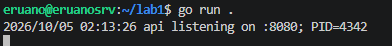

### Ответ в браузере:

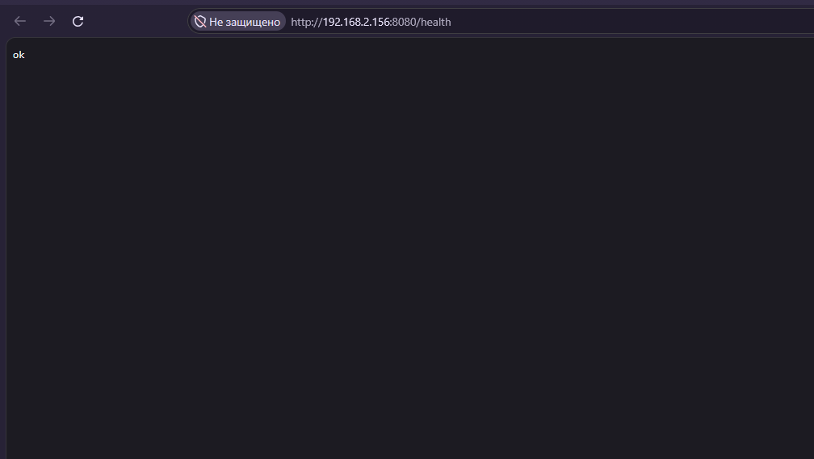

### ps тоже показывает пид процесса:

Это обычный процесс пользователя с PID `4348`. Отдельных namespaces и лимитов для него пока не задавал: он работает в окружении хоста. Сервис слушает обычный HTTP, поэтому в браузере использовал `http://`, без HTTPS.

## Часть 2. Namespaces

Через `unshare` создал отдельные пространства имён:

- `pid` — своя нумерация и видимость процессов;
- `mount` — своя таблица монтирований. `--mount-proc` заново монтирует `/proc`, чтобы он показывал процессы нового PID namespace;
- `net` — свои интерфейсы, адреса и маршруты. Изначально внутри только выключенный `lo`, маршрутов нет;
- `uts` — своё имя хоста, здесь `lab1`;
- `ipc` — отдельные System V IPC и POSIX message queues;
- `user` — своё отображение UID/GID: root внутри соответствует обычному пользователю с UID 1000 на хосте.

Mount namespace сам по себе не создаёт отдельную корневую файловую систему: файлы хоста в этом опыте остаются доступны в рамках прав пользователя. И namespaces не ограничивают потребление ресурсов — это проверяю дальше через cgroup.

### Эффект unshare:
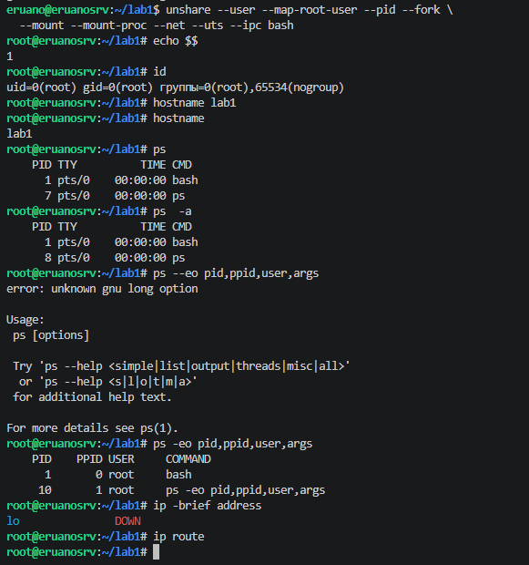

### Запустил сервер:
Видно, что теперь сервер считает, что у него пид 1

### Как выглядит ситуация на хосте под тем же пользователем:
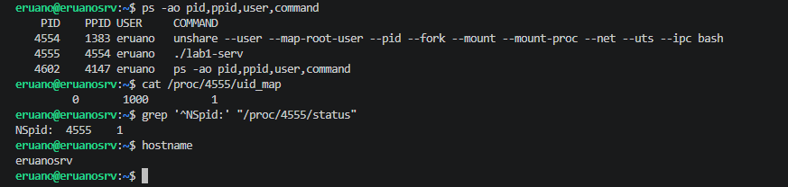

При запущенном сервере можем зная пид сделать запрос на сервер:

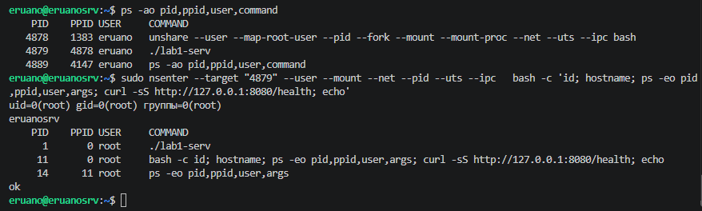

Внутри сервер стал PID 1, а снаружи виден под другим PID и обычным пользователем. Для HTTP-запроса вошёл через `nsenter --net` в его network namespace: loopback хоста и loopback сервиса теперь относятся к разным сетям.

## Часть 3. Cgroup v2

Установил лимиты:

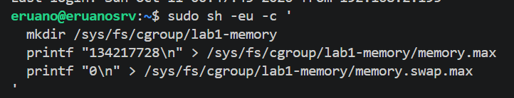

Запустил сервер:

Проверил лимиты:

Попытался забрать больше памяти чем положено, оом сработал:

Приложение завершилось:

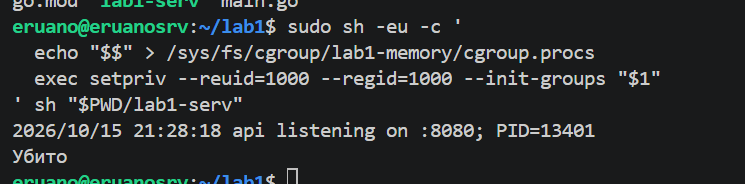

Поставил `memory.max=134217728`, то есть 128 МиБ, и `memory.swap.max=0`, чтобы процесс не ушёл в swap. Запрос на 256 МиБ превысил лимит. В `memory.events` получил `oom=1` и `oom_kill=1`, а список `cgroup.procs` стал пустым. После завершения процесса память освободилась, поэтому небольшое значение `memory.current` после опыта не означает, что лимит не сработал: событие осталось в счётчике.

### CPU

Ограничения задал:

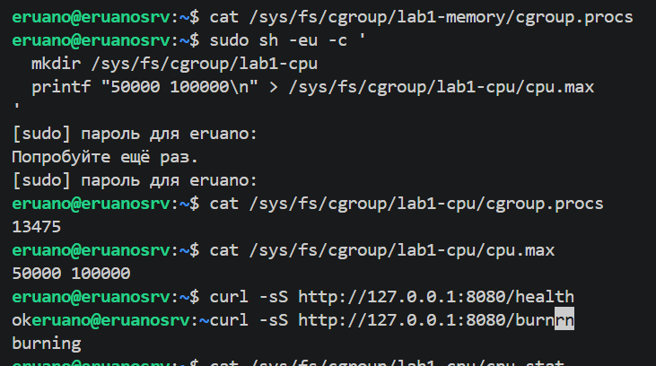

Сервис тротлит, что видно по статистике, но продолжает отвечать:

`cpu.max=50000 100000` даёт всей группе 50 мс CPU-времени на период 100 мс — в среднем половину ядра. Когда квота заканчивается, задачи ждут следующего периода, процесс при этом не убивается. Между двумя замерами `nr_periods` и `nr_throttled` выросли на 403: ограничение срабатывало в каждом из этих периодов. `/health` продолжал возвращать `ok`.

### Proc:

Создали сгруп и проверил настройки

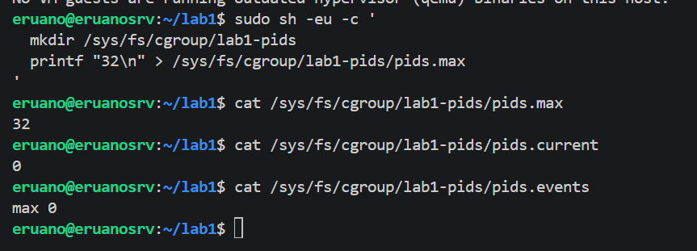

Запустил стресс-тест

Увидел увеличение счётчика:

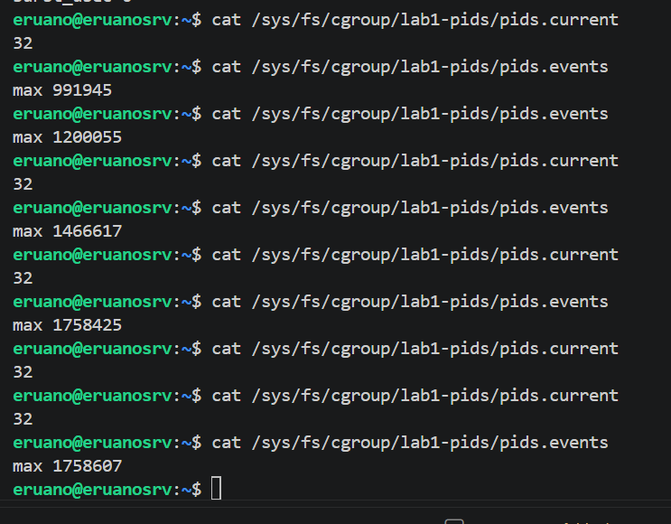

Здесь лимит `pids.max=32`: `pids.current` держится на 32, а `pids.events max` растёт из-за отказов создать новые задачи. Это разные показатели — текущее число задач и накопленное число срабатываний лимита. Учитываются и процессы, и потоки. После завершения нагрузки `pids.current` упал до 0, итоговый счётчик `max` остался равен 1763615.

Такой лимит защищает не только CPU: каждый новый процесс или поток тоже требует памяти и ресурсов ядра.

## Часть 4. Привилегии

Ограничил возможности пользователя в изолированном пространстве:

После `setpriv` UID внутри остался равен 0, но наборы capabilities обнулились. Смена hostname до сброса работала, после — получила отказ. То есть одного имени root недостаточно для привилегированной операции: нужна соответствующая capability. `no_new_privs=1` дополнительно запрещает получать новые привилегии через `exec`. Обычные действия, разрешённые правами пользователя, остаются доступны.

С хоста достаём до сервера при том, что доступы на предыдущем скрине отобрали:

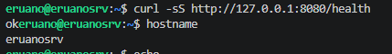

### seccomp

Сначала вызвал `getppid()` без фильтра — он вернул PID родителя. Затем через `enosys` подготовил `seccomp.bpf`, который для этого вызова возвращает `EPERM`:

В `strace` видно `getppid() = -1 EPERM`. Процесс Python при этом завершился с кодом 0: в этом профиле выбрано действие «вернуть ошибку», а не убить процесс. У seccomp бывают и другие действия.

Тот же фильтр не помешал HTTP-сервису ответить на `/health`: этот путь не требует запрещённого вызова. Capabilities ограничивают привилегированные действия, а seccomp фильтрует конкретные системные вызовы — здесь показал оба механизма отдельно.

## Часть 5. Собственный запуск и сравнение с Docker

Подготовлен [mydocker.sh](mydocker.sh), объединяющий namespaces, cgroup v2, удаление capabilities и загрузку seccomp. [Согласованный контракт и команды проверки](docs/contracts/mydocker.md).

Лимиты: память 128 MiB, swap 0, CPU 0,5, число задач 64. Внутри сервиса PID 1, на хосте — UID вызывающего пользователя. HTTP доступен через вход в network namespace; корневая файловая система остаётся хостовой. Управляющий процесс находится вне cgroup и очищает её при завершении.

Проверено пользователем на удалённом Debian 2026-10-16: `bash -n mydocker.sh` прошёл без ошибок; управляющий PID — `1783284`, PID сервиса на хосте — `1783296`, внутри — `1`, UID на хосте — `1000`. Скрипт вывел `Самопроверка запуска: OK`, запрос `/health` через `nsenter --net` вернул `ok`. После Ctrl+C отсутствие `/sys/fs/cgroup/lab1-1000-1783284` подтверждено сообщением `cgroup удалена`.

Docker на сервере проверен: Client/Engine `26.1.5+dfsg1`, containerd `1.7.24`, runc `1.1.15`; cgroup v2, драйвер `systemd`; SecurityOptions: AppArmor, встроенный seccomp, cgroupns. [Команды сравнения с Docker](docs/docker-comparison.md). Пользователь подтвердил запуск `lab1-docker`: `/health` через `127.0.0.1:8081` вернул `ok`; PID на хосте `1783516`, внутри — `1`; UID `1000`; `CapEff=0`, `NoNewPrivs=1`, `Seccomp=2`. Отображение UID прямое: `0 0 4294967295`. Фактические файлы cgroup показали `memory.max=134217728`, `memory.swap.max=0`, `cpu.max=50000 100000`, `pids.max=64`. После `docker stop lab1-docker` контейнер исчез из `docker ps -a`, как и ожидается при `--rm`.

| Механизм | mydocker.sh | Проверенный запуск Docker |
|---|---|---|
| PID сервиса внутри | 1 | 1 |
| Лимиты ресурсов | 128 MiB, swap 0, 0,5 CPU, 64 задачи | Те же значения в cgroup |
| Пользователь | UID 0 внутри отображён в UID 1000 хоста | UID 1000 внутри и на хосте; `--user` не создаёт отображление UID |
| Capabilities / no_new_privs | Cap-наборы обнулены, no_new_privs=1 | CapEff=0, no_new_privs=1 |
| Seccomp | Учебный BPF-профиль, запрещающий getppid с EPERM | Встроенный профиль Docker; режим filter подтверждён, правила отличаются |
| Сеть | Отдельный loopback; обращение через nsenter | Bridge и публикация порта 8081 хоста на 8080 контейнера |
| Корневая файловая система | Файлы хоста, отдельного rootfs нет | Образ Debian, бинарник подключён read-only bind mount |
| Очистка | Trap и cgroup.kill; удаление группы после Ctrl+C подтверждено | Управление через daemon/runtime; удаление контейнера после stop с --rm подтверждено |

Вывод: базовую изоляцию и лимиты обеспечивают одни и те же механизмы ядра. Docker дополнительно организует rootfs из образа, сеть и публикацию портов, управление жизненным циклом и логами. Bridge сам по себе не публикует порт: для запроса на порт 8081 хоста нужна отдельная настройка публикации. Отдельные проверки SIGTERM и OOM именно для объединённого скрипта пока не проводились.

Запустил:

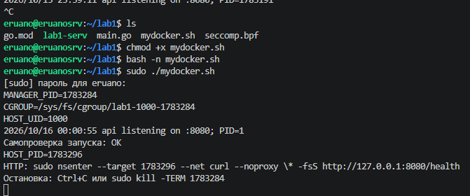

Проверка работает:

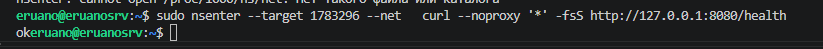

Запустил докер:

Проверил лимиты настройки, айдишники:

Завершил контейнер:

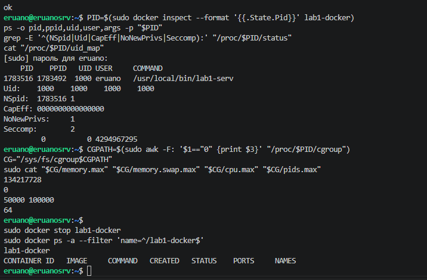

## Часть 6. Образы и хранение данных

Digest: sha256:20a022e5112a144aa7b7aeb3f22ebf2cdaefcc4aac0d64e8deeee8cdc18b9c0f
Status: Downloaded newer image for golang:1.24.4
docker.io/library/golang:1.24.4

Подготовлены [обычный Dockerfile](Dockerfile.single), [multi-stage Dockerfile](Dockerfile), [go.mod](go.mod) и [.dockerignore](.dockerignore) по [согласованному контракту](docs/contracts/images.md). [Команды сборки и проверки](docs/images.md).

Обе сборки используют Go 1.24.4, одинаковые исходники и статическую компиляцию с CGO_ENABLED=0. Обычный образ сохраняет toolchain, конечная стадия multi-stage основана на scratch и содержит только бинарник. Оба образа запускают сервис от UID/GID 1000:1000 на порту 8080.

`CGO_ENABLED=0` здесь нужен, чтобы бинарнику не требовались динамические C-библиотеки и загрузчик, которых нет в `scratch`. Сам Go runtime остаётся внутри бинарника, а ядро всё равно используется хостовое.

Пользователь подтвердил запуск обоих образов 2026-10-17. Контейнер single: `1ebb5f3658ecef706cdeac1c04cd09f4ab94231196283951a2c015df8c552445`, порт хоста 8081; multi: `8ef2bda454e69818dfc9c1e98538ead83330040d0860ef0eb0070597d1f6cdda`, порт 8082. Оба сервиса вывели PID=1 и вернули HTTP 200 с Content-Length: 2. Скриншот `screenshots/part-6/03-health-and-sizes.png` дополнительно подтверждает `single: OK` и `multi: OK`: точное тело `ok` и HTTP 200 для обоих образов.

Для обоих тегов image inspect подтвердил `User=1000:1000`, `Entrypoint=["/lab1-serv"]` и `Ports={"8080/tcp":{}}`. Команды измерения размеров, файловых слоёв и кэша добавлены в [инструкцию](docs/images.md). Измерения и повторное использование кэша подтверждены выводами пользователя и скриншотами.

| Образ | Размер, байт | Файловые слои | ID |
|---|---:|---:|---|
| `lab1-api:single` | 945094396 | 10 | `sha256:e8aa0744cec3941307b3887c191a7a93fd030c017a7266be58a99bad5c105437` |
| `lab1-api:multi` | 8089538 | 1 | `sha256:d12de3ca117b9bc2a055d7dcc8751fe3e95681e3a8d883dde41670391533087a` |

Размер multi примерно в 116,83 раза меньше single. История single содержит Go SDK, базовые пакеты и слой компиляции около 91,6 MB. История multi содержит только копирование бинарника около 8,09 MB; USER, EXPOSE и ENTRYPOINT представлены записями метаданных по 0 B. Число файловых слоёв подтверждено через RootFS.Layers, а не подсчётом строк history.

Builder: BuildKit, instance `default`, driver `docker`. Повторные сборки показали CACHED для WORKDIR, COPY go.mod/main.go и RUN go build в обоих образах. В multi также переиспользован COPY из стадии build. ID после повторных сборок совпадают с исходными измерениями.

Сравнение образов и кэша выполнено, проверка понимания пройдена. Команды опыта с writable layer добавлены в [инструкцию](docs/images.md): запись файла, restart того же контейнера и пересоздание из того же ID образа. Опыт с writable layer подтверждён выводом пользователя: в контейнер `b85ec0619492c22edbc6b139743700a9402654233a987929731e554777ed23d0` записан `/tmp/lab1-proof.txt` со строкой `lab1-proof`. `docker diff` показал `C /tmp` и `A /tmp/lab1-proof.txt`. После restart ID остался прежним, содержимое сохранилось. После stop/rm создан новый контейнер `dfc29e06e79553854a63551d79754e04ad6351cb075a792a9ed7f6477d839bcc` из того же ID образа; проверка подтвердила отсутствие файла. Вывод: restart сохраняет writable layer, удаление контейнера уничтожает его; исходный образ не изменяется. Проверка понимания пройдена.

Подготовлены команды named volume `lab1-images-data` в [инструкции](docs/images.md). Опыт с named volume подтверждён пользователем 2026-10-19. Создан новый `lab1-images-data` с драйвером local. Первый контейнер: `a92f56c2676678d138e69d921ac10918f596d7c055c5f45e98c7741d2977867f`; после stop/rm создан `5cb0a3c228fe66ae94accd00dca6b9b6997d11a229f54c605754ecf081db92ca`. Оба подключали тот же том к `/lab-data`, RW=true, Source=`/var/lib/docker/volumes/lab1-images-data/_data`. В `/lab-data/lab1-proof.txt` записана строка `volume-proof`; после пересоздания точная проверка содержимого прошла. Новый контейнер затем остановлен и удалён, а docker volume inspect подтвердил существование тома.

Volume — отдельное управляемое Docker хранилище, подключённое через mount, а не writable layer контейнера. Данные в этом опыте находятся за пределами жизненного цикла удаляемого writable layer. Если подключить другой новый том, по пути монтирования будет видно его пустое содержимое, а прежние данные останутся в старом томе. Все практические проверки части 6 и проверка понимания завершены: оба образа работают, размеры/слои/кэш измерены, writable layer исчез после удаления контейнера, named volume сохранил данные после пересоздания. Пользователь правильно объяснил, что файл в /lab-data хранится в отдельном подключённом томе. Том lab1-images-data оставлен на сервере для защиты.

eruano@eruanosrv:~/lab1$ sudo env BUILDKIT_PROGRESS=plain docker build -f Dockerfile.single -t lab1-api:single .

eruano@eruanosrv:~/lab1$ sudo env BUILDKIT_PROGRESS=plain docker build -f Dockerfile -t lab1-api:multi .

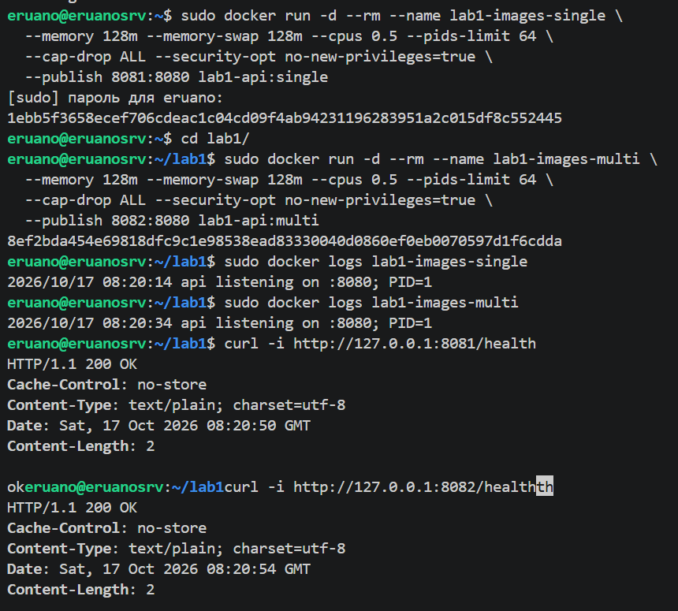

eruano@eruanosrv:~/lab1$ sudo docker image inspect lab1-api:single lab1-api:multi \
  --format '{{json .RepoTags}} User={{.Config.User}} Entrypoint={{json .Config.Entrypoint}} Ports={{json .Config.ExposedPorts}}'
["lab1-api:single"] User=1000:1000 Entrypoint=["/lab1-serv"] Ports={"8080/tcp":{}}
["lab1-api:multi"] User=1000:1000 Entrypoint=["/lab1-serv"] Ports={"8080/tcp":{}}
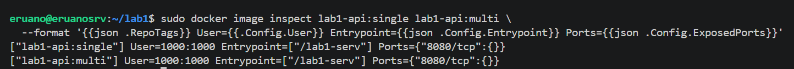

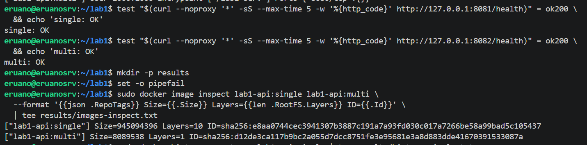

Слои сингла:
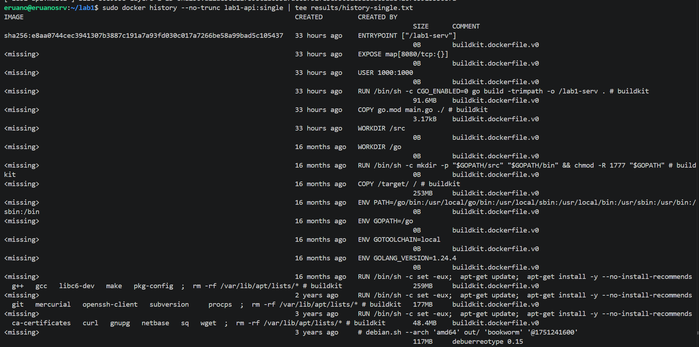

Слои мультистейджа:
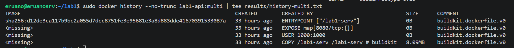

Кэш сингл сборки:

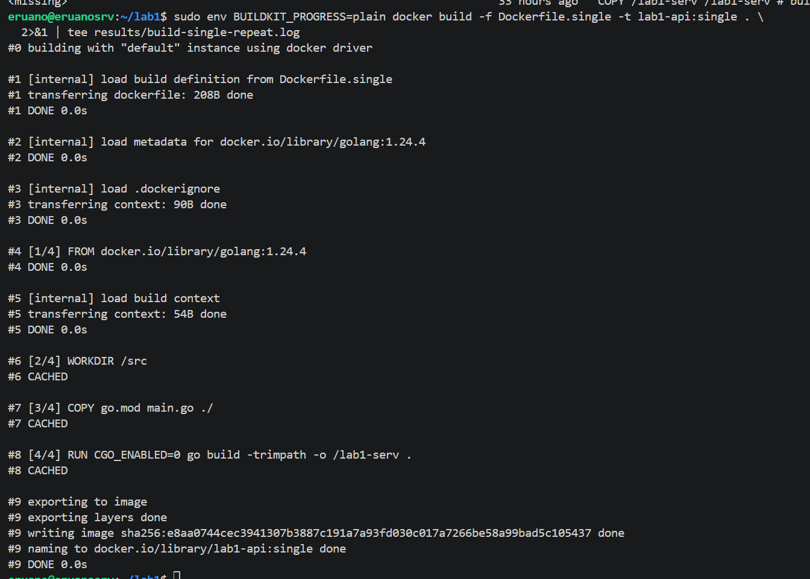

Кэш мультистейдж сборки:

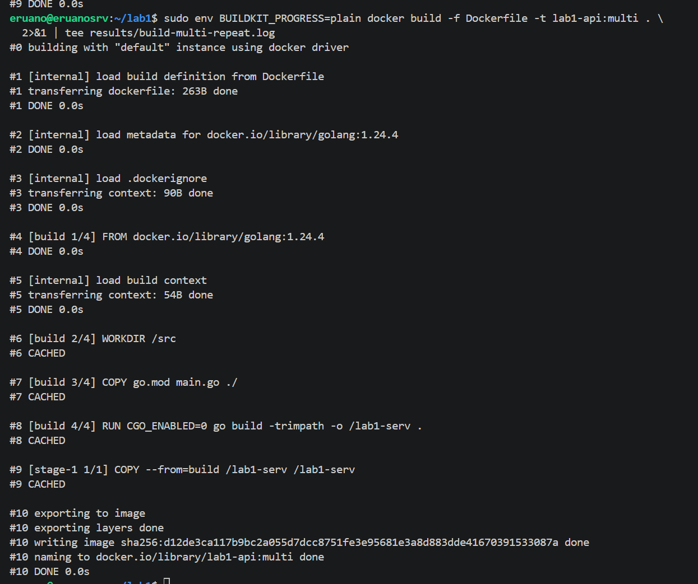

Исходники между этими сборками не менял, поэтому BuildKit взял шаги из кэша. Если поменять `main.go`, изменится вход для `COPY`, и зависящий от него `RUN go build` выполнится заново.

### Записываемый слой контейнера:

Запустил контейнер из конкретного ID образа, чтобы при пересоздании не поменялся сам исходный образ:

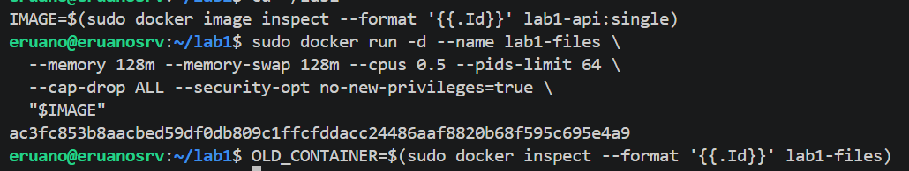

ID первого запуска: `ac3fc853b8aacbed59df0db809c1ffcfddacc24486aaf8820b68f595c695e4a9`.

Записал файл в `/tmp`, а `docker diff` показал добавление файла в записываемом слое:

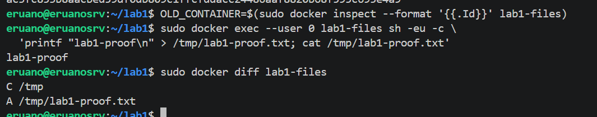

Затем повторил полный опыт: после `restart` это тот же контейнер и файл на месте. После `stop/rm` создал новый контейнер из того же образа — файла уже нет. Ошибка `No such object` в начале скрина относится к попытке посмотреть уже удалённый контейнер; ниже показан успешный повтор.

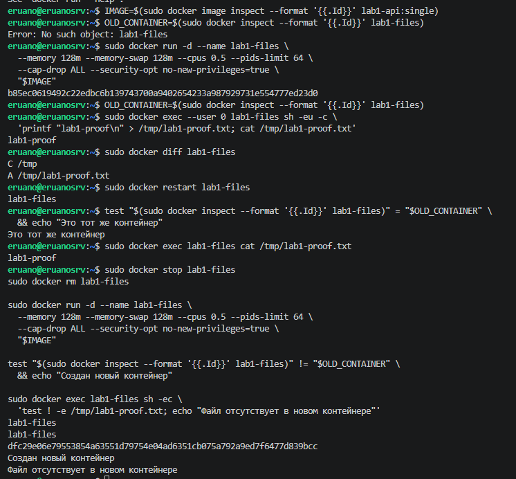

### Тома:

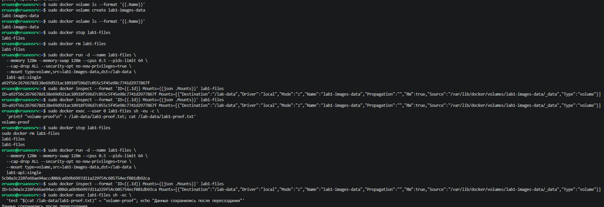

Теперь файл записан в `/lab-data`, куда подключён том `lab1-images-data`. Контейнер новый, том тот же, поэтому строка `volume-proof` сохранилась. Данные лежат в отдельном хранилище, а не в удаляемом writable layer.

## Часть 7. GVisor и границы изоляции

Исходная проверка пользователем: `command -v runsc` не вывел путь; Docker Runtimes содержит `runc` и `io.containerd.runc.v2`, runtime `runsc` не зарегистрирован. На момент проверки работали тестовые `lab1-images-single` и `lab1-images-multi` (Up 39 hours).

Пользователь остановил оба тестовых контейнера; последующий `docker ps` показал пустой список. Проверка `/etc/docker/daemon.json`: файл отсутствует.

[Подготовка gVisor](docs/gvisor.md) содержит команды добавления официального apt-репозитория, установки `runsc`, проверки конфигурации и её применения. Пакет установлен, сервис запущен через gVisor; ниже сохранил результаты и выводы.

Подтверждена установка пакета `runsc 20261012.0`: `runsc version release-20261012.0`, OCI spec `1.2.1`. Сразу после установки автоматическая регистрация не произошла: `/etc/docker/daemon.json` отсутствовал, Docker `active`, `Default=runc`, runtime `runsc` не перечислен. Проверка `dockerd --validate` завершилась ошибкой отсутствия файла, поэтому перезапуск после `&&` не выполнялся. Причина поведения установщика не установлена. Затем пользователь выполнил `sudo runsc install`: создана запись `runtimes.runsc.path=/usr/bin/runsc` в `daemon.json`. Проверка: `configuration OK`; после перезапуска Docker `active`, `Default=runc`, runtime `runsc` зарегистрирован. В объявленных параметрах runtime `platform=systrap`; на этом этапе фактический запуск приложения ещё не был проверен. Далее подготовлены команды запуска `lab1-api:multi` с `--runtime=runsc`, проверки HTTP и процессов хоста.

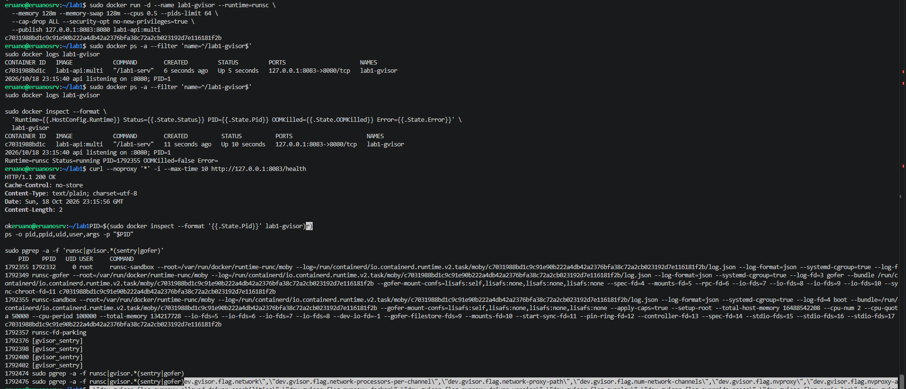

Подтверждён запуск `lab1-api:multi` через `runsc`: контейнер `c7031988bd1c9c91e90b222a4db42a2376bfa38c72a2cb023192d7e116181f2b`, Status=running, OOMKilled=false, Error пустой. Лог приложения: PID=1. HTTP на `127.0.0.1:8083/health`: 200 OK, тело `ok`. Docker State.Pid=1792355; на хосте это `runsc-sandbox` (UID 0), а не обычный процесс `/lab1-serv`. Также видны `runsc-gofer` PID 1792349, `runsc-fd-parking` и процессы `[gvisor_sentry]`. Командная строка sandbox содержит `--systemd-cgroup=true`, `--cpu-quota 50000`, `--cpu-period 100000`, `--total-memory 134217728`. Пользователь затем прочитал cgroup `/sys/fs/cgroup/system.slice/docker-c7031988bd1c9c91e90b222a4db42a2376bfa38c72a2cb023192d7e116181f2b.scope`: `memory.max=134217728`, `memory.swap.max=0`, `cpu.max=50000 100000`, `pids.max=64`. Настройки лимитов подтвердил чтением файлов cgroup. Позже в части 8 дал этому же сервису нагрузку и посмотрел память, CPU и throttling на дашборде. UID sandbox не является UID приложения внутри gVisor.

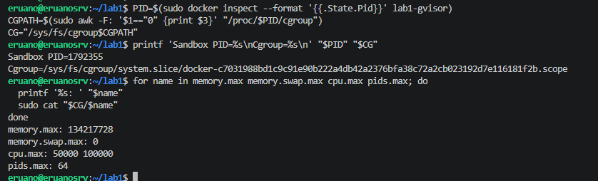

В обычном Docker и моём `mydocker.sh` системные вызовы приложения обрабатывает ядро хоста. Namespaces меняют видимость ресурсов, cgroups задают лимиты, но ядро остаётся общим — в этом и предел такой изоляции.

У gVisor между приложением и хостом появляется Sentry: он сам реализует интерфейсы ядра и обрабатывает системные вызовы приложения. Например, PID 1 приложение получает из таблицы процессов gVisor. Поэтому Docker здесь показывает PID `runsc-sandbox`, а не обычного процесса `/lab1-serv`, как с runc. Сам gVisor тоже работает поверх ядра хоста, просто приложение взаимодействует с ним через дополнительную границу.

За эту границу платим памятью на компоненты gVisor и дополнительной работой при обработке вызовов. Есть и ограничения совместимости: не все интерфейсы Linux реализованы полностью. Успешный `/health` показывает, что наш сервис работает, но не доказывает совместимость любого приложения. Точное замедление относительно runc отдельно не измерял.

## Часть 8. Мониторинг

Поднял Prometheus, Grafana и Alertmanager в kind через Helm. На самом Debian-хосте запустил cAdvisor и подключил его к Prometheus: `cAdvisor → Prometheus → Grafana`. Так снимаю метрики внешнего Docker-контейнера `lab1-gvisor`, включая накладные расходы его sandbox. [Настройки Helm](monitoring/values.yaml), [подключение cAdvisor](monitoring/cadvisor.md), [команды опыта](monitoring/experiment.md).

Сначала посмотрел на сервис без нагрузки: `up=1`, память около 25 млн байт, CPU почти не занят. `up` здесь показывает доступность cAdvisor для Prometheus. Сам HTTP-сервис этим запросом не проверяется.

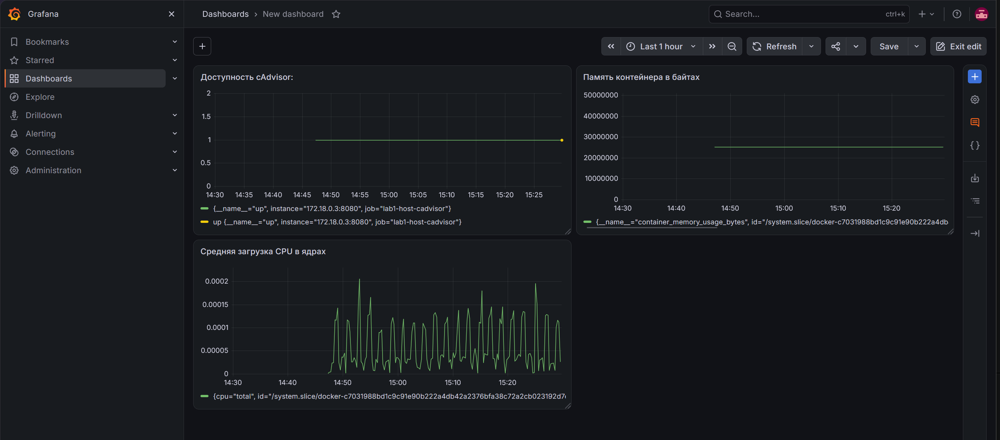

Сделал сначала выделение памяти, потом включил потребление процессора:

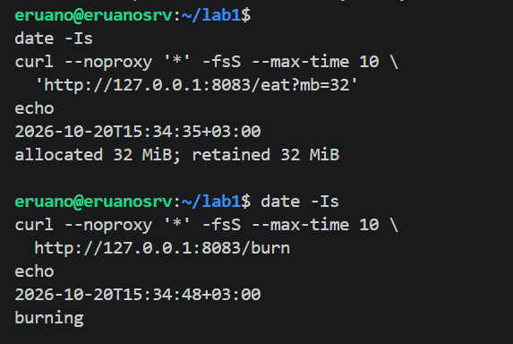

В 15:34:35 запросил 32 МиБ, сервис ответил `allocated 32 MiB; retained 32 MiB`. В 15:34:48 включил `/burn` и получил `burning`. Это время сервера, `+03:00`.

Графики зашевелились:

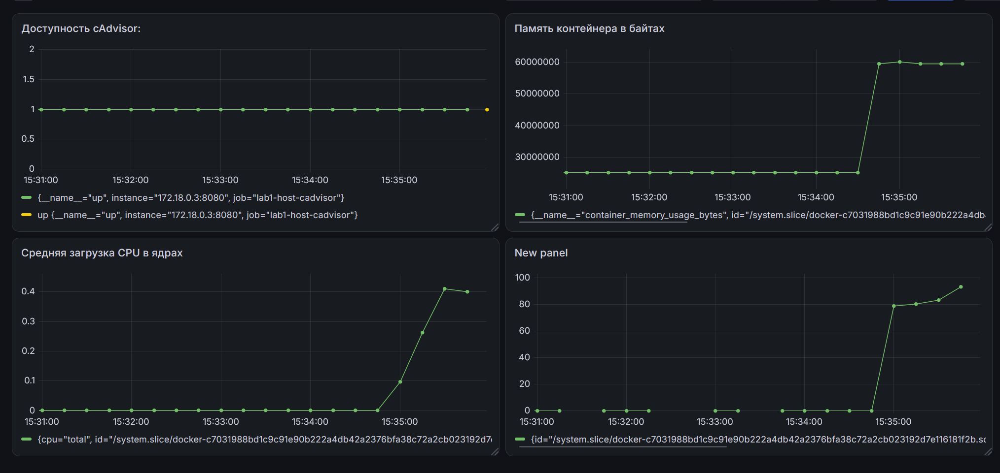

Память выросла примерно с 25 до 59–60 млн байт: сервис удерживает выделенные 32 МиБ, плюс остаются его обычные расходы и расходы gVisor. CPU растёт постепенно, потому что на панели считаю `rate(...[1m])` — среднее за минуту, а не мгновенную нагрузку.

4 график - тротлинг:

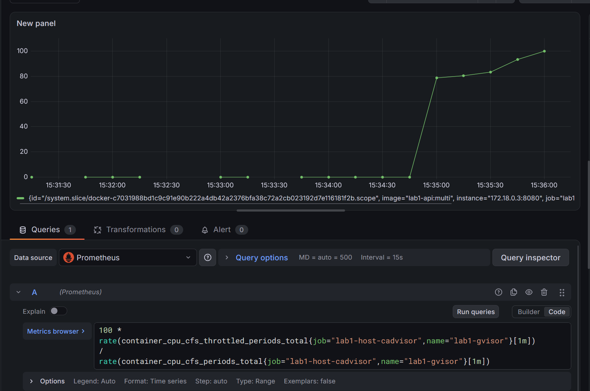

Throttling считаю как `100 × rate(throttled_periods[1m]) / rate(periods[1m])`. После включения нагрузки доля дошла до 100%: квота заканчивается в каждом учитываемом CFS-периоде. Это не значит, что сервис всё время стоит и совсем не получает CPU. На соседнем графике он как раз потребляет около 0,5 ядра — весь разрешённый лимит.

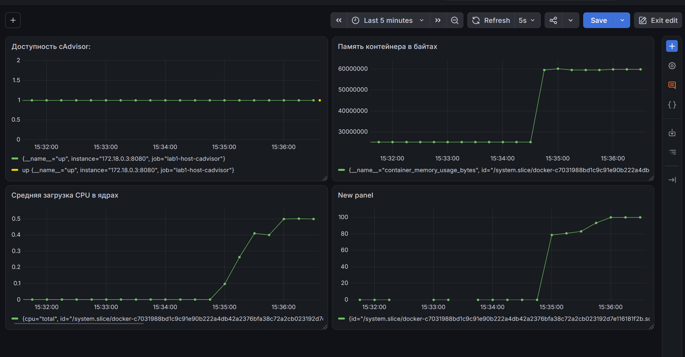

Убил процесс:

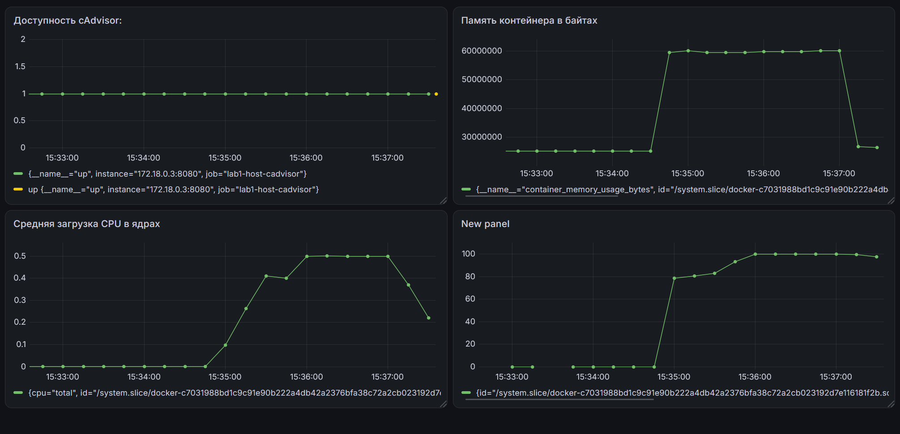

Память вернулась примерно к 26 млн байт, CPU на последних точках начал снижаться. Доля throttling на этом снимке ещё высокая: расчёт всё ещё захватывает минуту, в которой была нагрузка. По этому кадру нельзя сказать, что она уже упала до нуля. При этом `up` остался равен 1 — cAdvisor продолжал отвечать во время опыта.

Итого: на дашборде видны и выделение памяти, и упор в CPU-квоту, и завершение нагрузки. Три метрики для алертов с обоснованием ещё предстоит выбрать. Экспорт дашборда в JSON в папке `monitoring/` пока не сохранён.

### Исходный замер мониторинга

Python `/usr/bin/python3`, версия 3.13.5. Контейнер `lab1-gvisor` running, sandbox PID 1792355; cgroup `system.slice/docker-c7031988bd1c9c91e90b222a4db42a2376bfa38c72a2cb023192d7e116181f2b.scope`.

| Показатель | Получено |
|---|---:|
| memory.current | 25235456 байт (24,07 МиБ, 18,80% лимита) |
| memory.max | 134217728 байт |
| memory.events | low/high/max/oom/oom_kill/oom_group_kill — все 0 |
| cpu.max | 50000 100000 |
| usage_usec | 5152759 |
| user_usec / system_usec | 4033382 / 1119376 |
| nice_usec | 40000 |
| nr_periods / nr_throttled | 4326 / 1 |
| throttled_usec | 156957 |
| nr_bursts / burst_usec | 0 / 0 |
| pids.current / pids.max | 28 / 64 |

Это исходный замер до нагрузки: CPU-время и throttling накоплены за время существования cgroup. По одной точке текущую загрузку и долю периодов throttling за интервал не посчитать — дальше для графиков использовал `rate`. 28 задач cgroup не означают 28 экземпляров HTTP-сервиса.

Перед установкой общего стека Kubernetes/Helm отсутствовали. Сервер: 16 логических CPU, 15 GiB RAM (14 GiB available); свободно было 27 GiB на / и 9,4 GiB на /var. Docker 26.1.5, cgroup v2/systemd, default runtime runc; lab1-gvisor работал. [Команды установки и создания kind](monitoring/cluster.md); результат установки приведён ниже.

### Учебный Kubernetes-кластер готов

Подтверждено пользователем: kind `v0.33.0`, kubectl `v1.35.8` (Kustomize `v5.7.1`), Helm `v4.3.1+gc0d08d0`. Создание `lab1-monitoring` успешно, Ready after 15s. Узел `lab1-monitoring-control-plane` — `Ready`, Kubernetes `v1.35.8`, IP `172.18.0.2`, containerd `2.3.4`, ядро `6.12.111+deb13-amd64`. Все девять системных подов `Running`, перезапусков 0 в предоставленном замере. После создания на `/var` было свободно 7,5 GiB, занято 32%. Дальше установил Prometheus/Grafana/Alertmanager.

### Основа мониторинга: подготовлены конфигурации

Созданы [Helm values](monitoring/values.yaml) и [инструкция установки](monitoring/README.md) для kube-prometheus-stack 92.10.1: Prometheus, Grafana, Alertmanager. Хранение Prometheus — 6h, retentionSize 512MB; PVC Prometheus/Grafana/Alertmanager — 1Gi/256Mi/128Mi соответственно. Эти конфигурации использовал для установки Helm-релиза. Затем открыл Grafana через браузер и подключил внешний cAdvisor, чтобы видеть именно lab1-gvisor.

### Helm-релиз мониторинга установлен

По выводу пользователя от 20.10.2026: `lab1`, namespace `monitoring`, revision 1, `deployed`, chart `kube-prometheus-stack-92.10.1`, app version оператора `v0.94.1`. Все шесть подов готовы и `Running`, перезапусков 0. PVC Prometheus 1Gi, Grafana 256Mi и Alertmanager 128Mi — `Bound`, StorageClass `standard`. На `/var` в этом замере свободно 5,4 GiB, занято 51%. После установки открыл Grafana через SSH-туннель и подключил внешний cAdvisor.

В [инструкции подключения cAdvisor](monitoring/cadvisor.md) сохранены команды для CPU, памяти и throttling внешнего `lab1-gvisor`. На графиках выше видны и job `lab1-host-cadvisor`, и ID нужного контейнера: данные дошли до Prometheus и Grafana.

### Источник cAdvisor проверен

cAdvisor `v0.60.6` запущен пользователем на хосте, IP `172.18.0.3` в Docker-сети kind. Digest образа: `sha256:b8e7d1093144fd088f425ff003d75a4aa405de075db78dae3bc563730b1bd07a`. На `/metrics` подтверждены серии с `name="lab1-gvisor"` и ID нужного контейнера: память 25235456 байт, лимит 134217728 байт, CPU 10.668821 секунд, CFS periods 9129, throttled periods 1, throttled seconds 0.156957. Это исходный замер прямо с cAdvisor. Затем в Helm values добавил job `lab1-host-cadvisor`, target `172.18.0.3:8080`, с фильтром только на серии `lab1-gvisor`. На скриншотах дашборда видно `up=1` и метрики с нужным ID контейнера — сбор в Prometheus работает.

### Панели Grafana и подготовка нагрузки

После обрыва `port-forward` повторный запуск восстановил доступ к Grafana. Причина разового `connection refused` не установлена: диагностических логов нет. Затем добавил панели и выполнил [опыт с нагрузкой](monitoring/experiment.md), результат виден на скриншотах выше. Есть четыре панели: доступность cAdvisor, память, CPU и throttling. Экспорт JSON пока не приложен.

## Материалы для защиты

- Код сервиса и Dockerfile.
- `mydocker.sh` и профиль seccomp.
- `README.md` с описанием и выводами.
- Скриншоты: PID внутри и снаружи; OOM; throttling; отказы seccomp/capabilities; работа `mydocker.sh`; сравнение размеров образов; дашборд.
- Остаётся добавить выбор и обоснование трёх метрик для алертов и экспорт JSON дашборда. Оглавление артефактов и краткие выводы — в [README.md](README.md).
