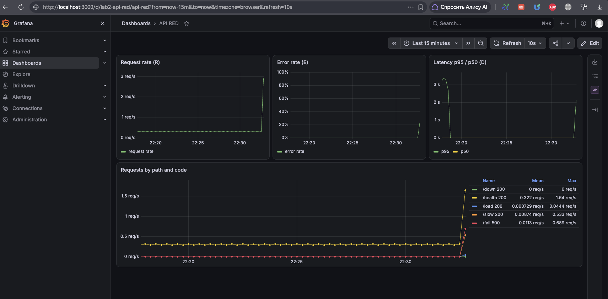
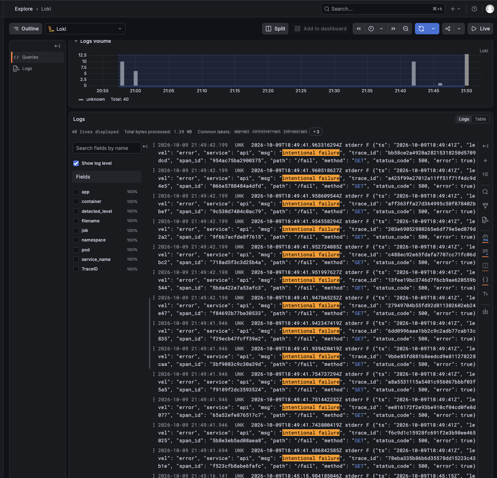
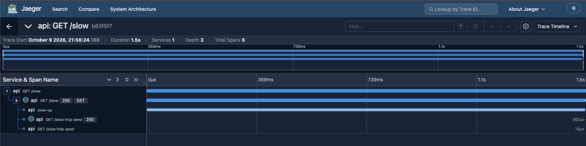
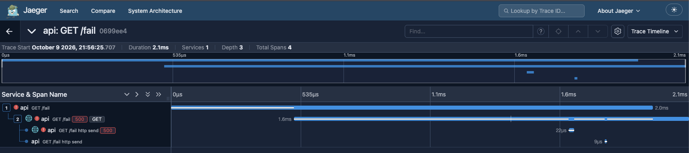
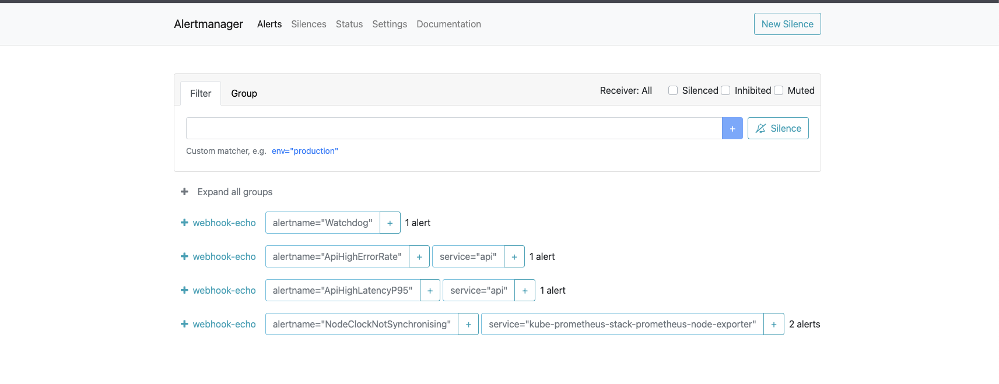
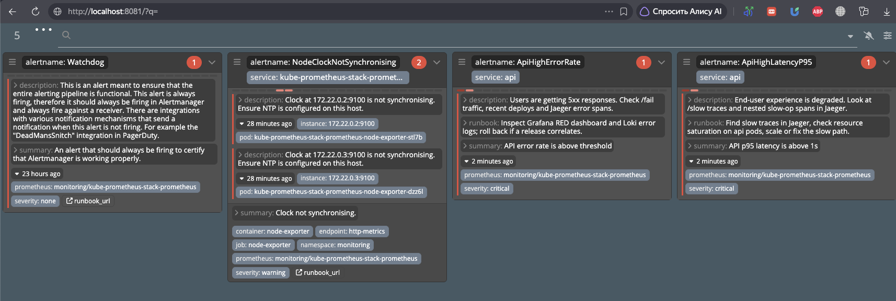

# Lab 2 — Service monitoring: metrics, logs, traces

## Запуск

```bash
cd dev-ops/lab2  # из корня этого репозитория
./scripts/up.sh
```

Скрипт:

1. создаёт kind-кластер `lab2` (control-plane + worker);
2. собирает образ `lab2-api:latest` и загружает его в kind;
3. ставит все компоненты стека Helm-релизами в `monitoring` и `app`.

Port-forward (в отдельных терминалах):

```bash
kubectl -n app port-forward svc/api 8000:8000
kubectl -n monitoring port-forward svc/kube-prometheus-stack-grafana 3000:80
kubectl -n monitoring port-forward svc/kube-prometheus-stack-prometheus 9090:9090
kubectl -n monitoring port-forward svc/kube-prometheus-stack-alertmanager 9093:9093
kubectl -n monitoring port-forward svc/jaeger-query 16686:16686
kubectl -n monitoring port-forward svc/karma 8081:8080
```

| UI | URL | Логин |
|----|-----|-------|
| API | http://localhost:8000 | — |
| Grafana | http://localhost:3000 | анонимный Viewer; для admin: `admin` / `admin` |
| Prometheus | http://localhost:9090 | — |
| Alertmanager | http://localhost:9093 | — |
| Jaeger | http://localhost:16686 | — |
| Karma | http://localhost:8081 | — |

Нагрузка:

```bash
# Сначала оставьте запущенным port-forward API из блока выше.
./scripts/traffic.sh all      # метрики / логи / трейсы
./scripts/traffic.sh alerts   # держать error+latency ~3 мин для firing
./scripts/traffic.sh down     # временно ломает scrape для firing ApiDown
```

Для алерта `ApiDown`:

```bash
./scripts/traffic.sh down
# /metrics отвечает 503 180 секунд — достаточно для for: 1m с учётом scrape/evaluation interval.
```

Отдельные сценарии и ручные запросы:

```bash
./scripts/traffic.sh health
./scripts/traffic.sh fail
./scripts/traffic.sh slow
./scripts/traffic.sh load

curl http://localhost:8000/health
curl -i http://localhost:8000/fail
curl http://localhost:8000/slow
curl http://localhost:8000/load
curl http://localhost:8000/metrics
```

## Структура репозитория

```text
lab2/
  api/                 # код сервиса + Dockerfile
  charts/api/          # Deployment, Service, ServiceMonitor, PrometheusRule, RED dashboard ConfigMap
  charts/jaeger-services/ # Helm chart с alias Service для OTLP и Jaeger UI
  charts/webhook/      # echo-receiver для Alertmanager
  charts/karma/        # Karma UI
  helm/                # values для kube-prometheus-stack, loki, alloy, jaeger
  dashboards/red.json  # копия RED-дашборда
  kind-config.yaml
  scripts/up.sh
  scripts/traffic.sh
  screenshots/         # сюда положить скриншоты для сдачи
  README.md
```

## Алерты

- `ApiHighErrorRate`: 5xx выше 5%; пользовательский сбой — проверить RED, Loki, error-spans и последний деплой.
- `ApiHighLatencyP95`: p95 выше 1 s; деградация UX — проверить `/slow` в Jaeger и ресурсы pod'ов API.
- `ApiDown`: API не scrape'ится; сервис может быть недоступен — проверить pod'ы, события и replicas.

## Скриншоты для сдачи

| Файл | Содержание |
|---------------|------------|
| `01-red-dashboard.png` | RED в Grafana |
| `02-logs-graphana.png` | ошибка `/fail` в Loki/Grafana |
| `05-jaeger-slow.png` | waterfall `/slow` с `slow-op` |
| `04-jaeger-fail.png` | error span для `/fail` |
| `05-alertmanager-firing.png` | firing в Alertmanager |
| `06-karma-firing.png` | те же алерты в Karma |

### RED-дашборд Grafana



### Логи `/fail` в Loki



### Трейс `/slow`: вложенный span `slow-op`



### Трейс `/fail`: ошибочный span



### Alertmanager: firing-алерты



### Karma: активные алерты



## Остановка

```bash
kind delete cluster --name lab2
```
