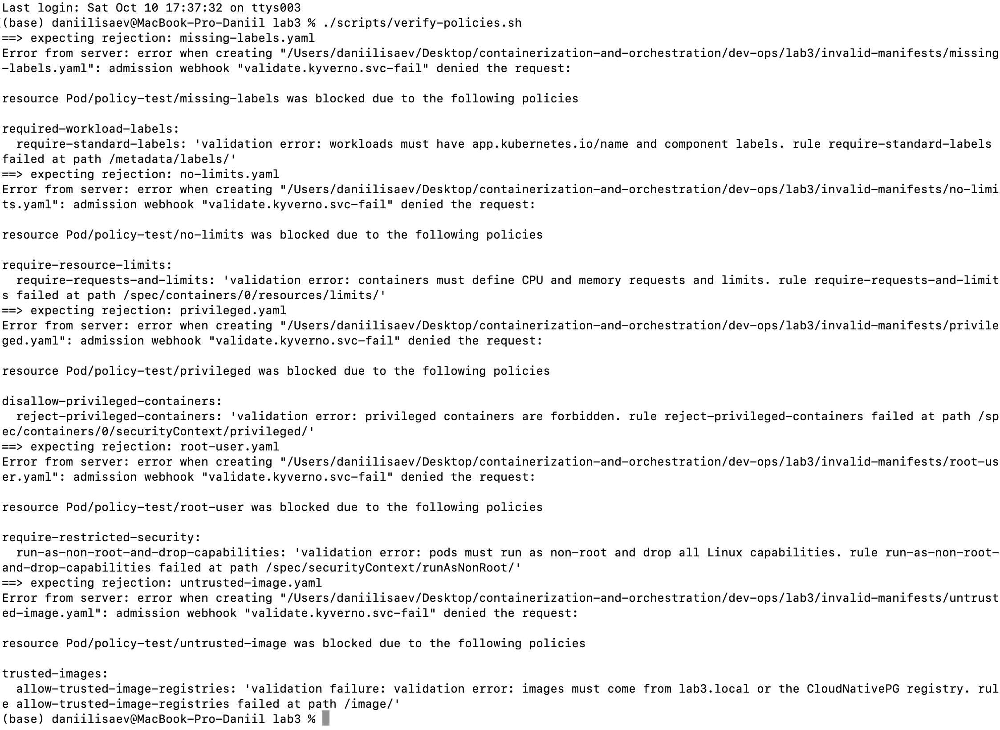
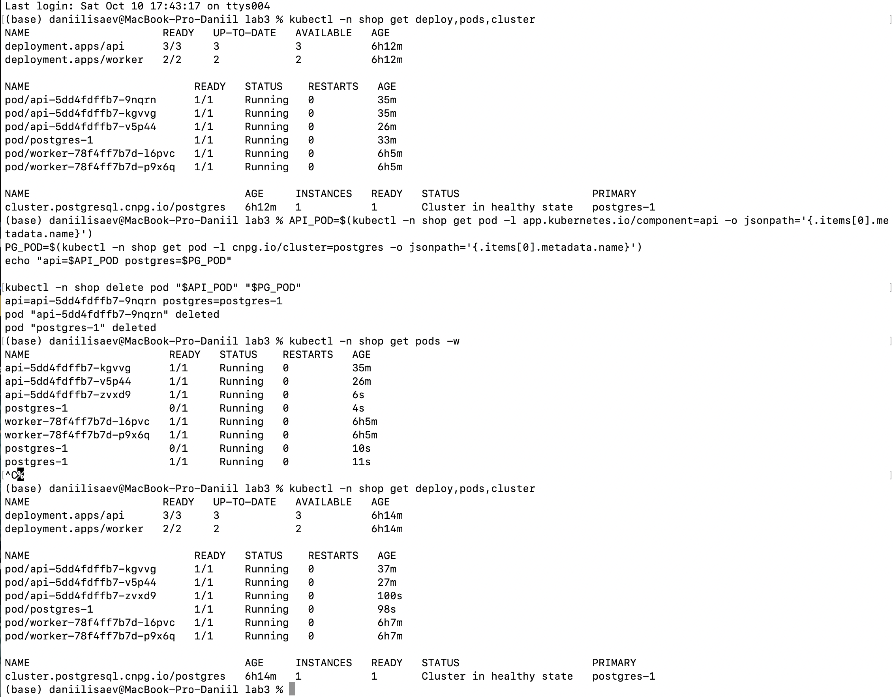
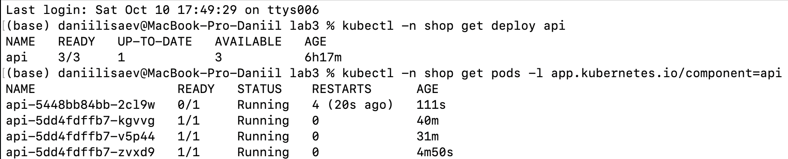
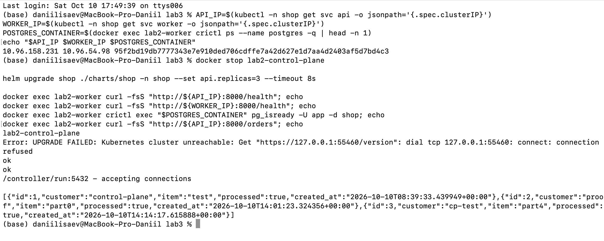
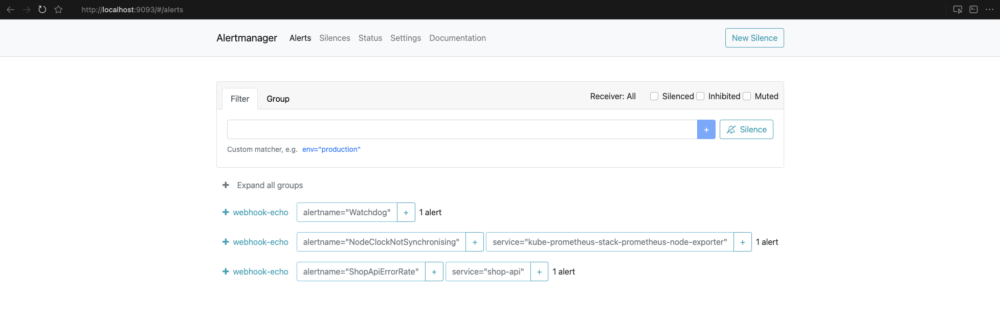
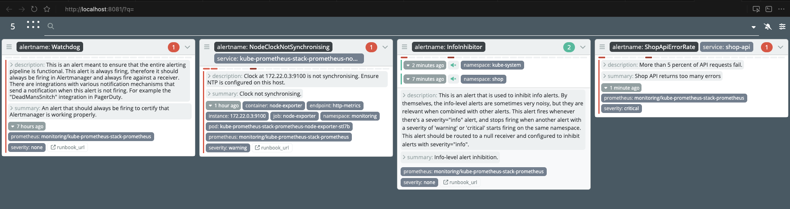

# Lab 3 — shop platform

`shop` запускается в namespace `shop` поверх существующего стека наблюдаемости Lab 2 в namespace `monitoring`. Новый Prometheus/Grafana/Alertmanager не создаётся.

## Запуск

```bash
cd dev-ops/lab3
./scripts/up.sh
kubectl -n shop port-forward svc/api 8000:8000
```

В отдельном терминале:

```bash
kubectl -n monitoring port-forward svc/kube-prometheus-stack-grafana 3000:80
kubectl -n monitoring port-forward svc/kube-prometheus-stack-alertmanager 9093:9093
kubectl -n monitoring port-forward svc/karma 8081:8080
```

## Политики

Выбран Kyverno: политики описываются Kubernetes-манифестами, поэтому их удобно читать, проверять и применять в локальном kind-кластере. Он подходит для admission-проверок без написания Rego.

| Политика | Зачем |
|---|---|
| `require-resource-limits` | Не даёт workload'у без requests/limits вытеснить остальные сервисы. |
| `trusted-images` | Разрешает только локальные образы `lab3.local` и официальный образ CloudNativePG. |
| `required-workload-labels` | Гарантирует метки для Service, мониторинга и поиска workload'ов. |
| `disallow-privileged-containers` | Не позволяет контейнеру получить расширенные права хоста. |
| `require-restricted-security` | Требует non-root и drop всех Linux capabilities. |

Инфраструктурные namespaces (`kube-system`, `monitoring`, `kyverno`, `cnpg-system`, `local-path-storage`) исключены, чтобы новая политика не ломала уже развёрнутые системные компоненты и provisioner volume. `shop` и `policy-test` проверяются.

Пять намеренно неверных манифестов:

```bash
./scripts/verify-policies.sh
```

Каждый файл в `invalid-manifests/` нарушает ровно одну политику и должен быть отклонён admission webhook.

## Reconciliation и rollout

```bash
./scripts/demo.sh reconcile-api
./scripts/demo.sh replicas 4
```

Проверка показала, что после удаления одного API pod Deployment вернул третью реплику, а после изменения `api.replicas` в `values.yaml` до `4` и `helm upgrade` API стало `4/4`.

Для rolling update опрашивайте Service с worker node, затем измените тег `api.image` в `values.yaml`, загрузите новый образ через kind и выполните `helm upgrade shop ./charts/shop -n shop --wait`.

```bash
API_IP=$(kubectl -n shop get svc api -o jsonpath='{.spec.clusterIP}')
while true; do docker exec lab2-worker curl -fsS "http://${API_IP}:8000/health"; sleep 0.2; done
```

У API `maxUnavailable: 0`, поэтому старые ready pod'ы остаются доступными до readiness новых.

```bash
./scripts/demo.sh broken-rollout
helm history shop -n shop
./scripts/demo.sh rollback <healthy-revision>
```

`broken-rollout` выставляет `HEALTH_FAIL=true`; новые pod'ы не проходят readiness, rollout не завершается, а старые endpoints продолжают отвечать. `rollback` возвращает указанную healthy-ревизию из `helm history`.

В проверке rollout остановился с `UP-TO-DATE: 1`, `AVAILABLE: 3`. После rollback API снова стал `3/3`.

## PostgreSQL operator

CloudNativePG установлен один раз в `cnpg-system`. Шаблон `Cluster` в chart создаёт Postgres и его persistent storage.

```bash
kubectl -n shop get cluster postgres -o yaml
kubectl -n shop delete pod -l cnpg.io/cluster=postgres
kubectl -n shop get pods -w
```

`spec` CR описывает желаемую базу: один инстанс, образ, storage, ресурсы и bootstrap. `status` заполняет оператор фактическим состоянием: primary, ready instances и условиями. `controller-manager` обслуживает встроенные Kubernetes-типы, а оператор — отдельный controller c предметной логикой Postgres: primary, storage, bootstrap и восстановление.

После удаления `postgres-1` CloudNativePG создал новый ready pod; у CR `postgres` `spec.instances: 1`, а `status` перешёл в `Cluster in healthy state`.

## Control plane outage

```bash
API_IP=$(kubectl -n shop get svc api -o jsonpath='{.spec.clusterIP}')
WORKER_IP=$(kubectl -n shop get svc worker -o jsonpath='{.spec.clusterIP}')
POSTGRES_CONTAINER=$(docker exec lab2-worker crictl ps --name postgres -q | head -n 1)
./scripts/demo.sh control-plane-down
helm upgrade shop ./charts/shop -n shop --set api.replicas=3 --timeout 8s  # должен завершиться ошибкой
docker exec lab2-worker curl -fsS "http://${API_IP}:8000/health"
docker exec lab2-worker curl -fsS "http://${WORKER_IP}:8000/health"
docker exec lab2-worker crictl exec "$POSTGRES_CONTAINER" pg_isready -U app -d shop
docker exec lab2-worker curl -fsS "http://${API_IP}:8000/orders"
./scripts/demo.sh control-plane-up
kubectl get pods
```

При остановленном control plane API server и etcd не принимают изменения, поэтому `kubectl apply` и `helm upgrade` не проходят. Уже запущенные containers выполняются kubelet на worker node. После запуска control-plane cluster снова принимает изменения.

В проверке `helm upgrade` получил `Kubernetes cluster unreachable`, но API `/health`, worker `/health`, `pg_isready` и API `/orders` продолжили отвечать. После запуска `lab2-control-plane` `kubectl` снова получил состояние deployments и pods.

## Monitoring

Chart создаёт `ServiceMonitor`, dashboard ConfigMap и три alert rules, scoped на namespace `shop`:

| Alert | Причина |
|---|---|
| `ShopApiDown` | API невозможно scrape'ить, следовательно сервис или наблюдаемость недоступны. |
| `ShopApiErrorRate` | Более 5% HTTP-ответов 5xx означает пользовательские ошибки. |
| `ShopOrdersLatencyP95` | p95 `/orders` больше секунды — деградация чтения заказов. |

Для firing `ShopApiErrorRate` оставьте API port-forward активным и выполните:

```bash
./scripts/demo.sh alert
```

Через 1–2 минуты alert будет виден в Alertmanager и Karma. Дашборд `Shop API` доступен в Grafana.

`ShopApiErrorRate` был подтверждён в состоянии `firing`.

## Скриншоты для сдачи

| Файл | Содержание |
|---|---|
| `01-policies.png` | Kyverno отклонил все пять invalid manifests |
| `02-shop-selfheal.png` | после удаления api и postgres pod'ы вернулись, cluster healthy |
| `03-broken-rollout.png` | `HEALTH_FAIL=true`: UP-TO-DATE 1, новый pod 0/1, старые 1/1 |
| `04-control-plane.png` | control plane down: helm unreachable, data plane отвечает |
| `05-alertmanager-shop-error-rate.png` | firing `ShopApiErrorRate` в Alertmanager |
| `06-karma-shop-error-rate.png` | тот же alert в Karma |

### Политики: rejection invalid manifests



### Self-heal: api и postgres после delete



### Broken rollout: новый pod не проходит readiness



### Control plane outage: API server недоступен, workload жив



### Alertmanager: firing `ShopApiErrorRate`



### Karma: активный `ShopApiErrorRate`


