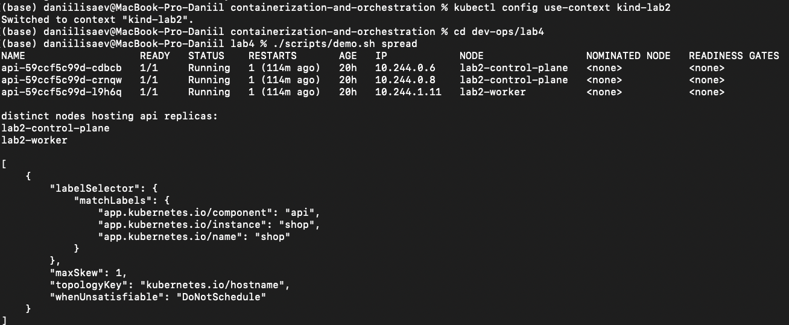
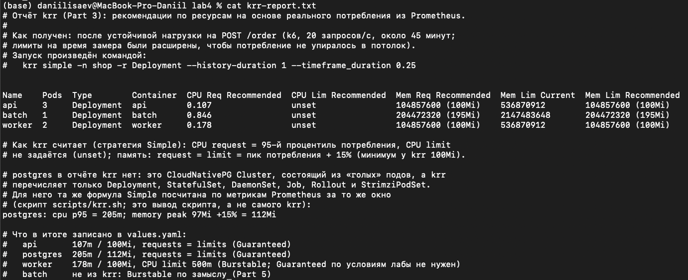
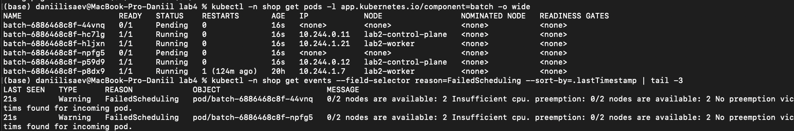
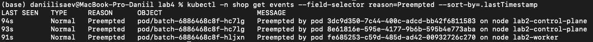
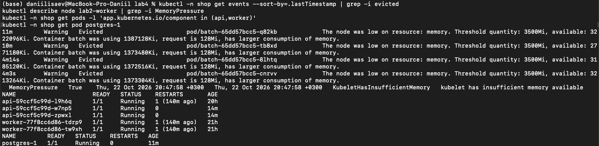
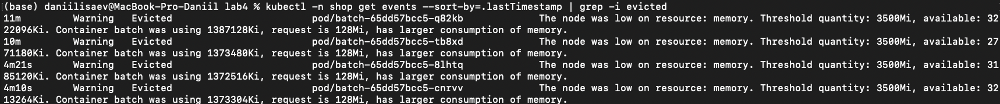
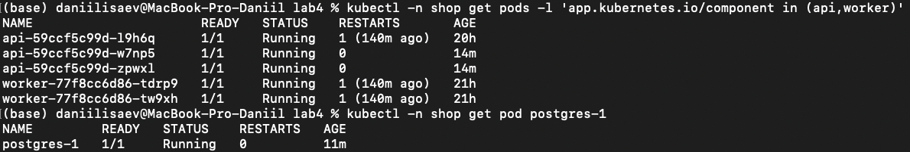
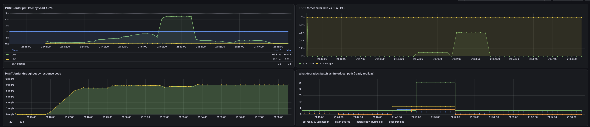
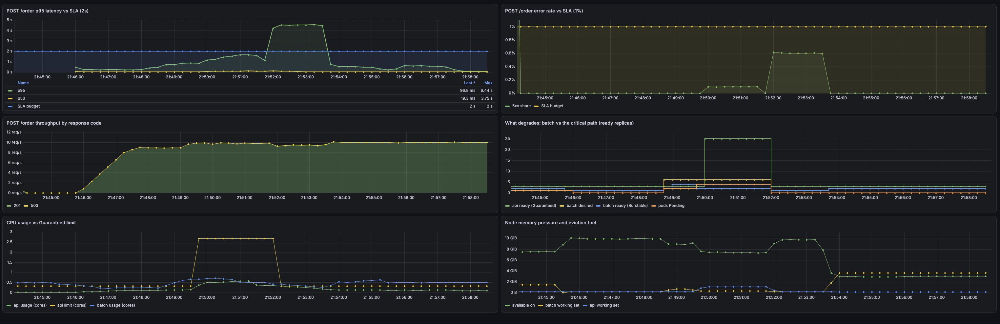

# Lab 4 — SLA критического пути под нагрузкой

`shop` из Lab 3 на kind-кластере Lab 2 (2 ноды: `lab2-control-plane`, `lab2-worker`) и тот же стек `monitoring`. Chart расширен: `batch`, spreading, PriorityClass, PDB, QoS по `krr`, дашборд и алерты по order path. Политики Kyverno не менялись, образ batch — `lab3.local/shop-batch:v1`.

## Запуск

```bash
cd dev-ops/lab4
./scripts/up.sh          # untaint control-plane, memory eviction в kubelet, образы, helm upgrade shop
kubectl -n monitoring port-forward svc/kube-prometheus-stack-prometheus 9090:9090
kubectl -n monitoring port-forward svc/kube-prometheus-stack-grafana 3000:80
```

Весь конфиг `shop` — только `charts/shop` (values и шаблоны). `up.sh` делает bootstrap кластера: снимает taint с control-plane (иначе api не может сесть на обе ноды) и возвращает kubelet `evictionHard.memory.available=3500Mi` (в kind его нет). Скрипты `demo.sh` только запускают `helm upgrade` с `--set` по values и наблюдают.

Нагрузка: `./scripts/load.sh` — k6 `POST /order` как Job внутри кластера (образ `lab3.local/shop-load:v1`), чтобы обрывы port-forward не выглядели как ошибки API. Код возврата k6 — выполнен ли SLA.

## Part 0 — batch

`batch/main.py`: бесконечный цикл, который жжёт CPU (доля занятости `cpuDuty` % каждые 100 мс) и держит RSS = `MEMORY_MB`; `GET /health`. Non-root 10001, drop ALL, requests и limits заданы.

## Part 1 — spreading

В `values.yaml`: `api.spreading: topologySpreadConstraints` (или `podAntiAffinity`); в шаблоне `api.yaml` — `if/else`, оба варианта рендерятся из этого параметра.

**Чем они отличаются.**

| | `podAntiAffinity` | `topologySpreadConstraints` |
|---|---|---|
| Идея | «не класть этот pod рядом с подами, у которых такой label» | «держать число подов по доменам ровным: разница ≤ `maxSkew`» |
| Строгость | два режима: `required` (жёстко, иначе `Pending`) и `preferred` (мягко, без гарантии) | число, которое настраивается: `maxSkew`, плюс `DoNotSchedule` (жёстко) или `ScheduleAnyway` (мягко) |
| Что считает | только «есть ли рядом такой pod» (0 или 1) | сколько подов уже в каждом домене |
| Домены | в основном нода/зона по `topologyKey` | любой `topologyKey` (нода, зона, регион), поддерживает несколько ограничений сразу |
| Реплик больше, чем доменов | `required` оставляет лишние реплики в `Pending` | распределяет по очереди с перекосом ≤ `maxSkew` |

**Почему выбран `topologySpreadConstraints`** (`topologyKey: kubernetes.io/hostname`, `maxSkew: 1`, `whenUnsatisfiable: DoNotSchedule`). В лабе 3 реплики api и 2 ноды. `required` anti-affinity запрещает две реплики на одной ноде, поэтому третья навсегда осталась бы `Pending`: на двух нодах для неё нет места. `preferred` anti-affinity не даёт гарантии, что реплики окажутся на разных нодах. Spread с `maxSkew: 1` даёт именно нужное: раскладку 2+1, при которой реплики гарантированно лежат на обеих нодах, и ни одна не зависает. Это же «даже на кластере из 1–2 нод» из условий.

**Ограничение выбранного механизма.** Spread учитывается только при планировании нового пода. Если реплики потом удаляются (например, scale-down), уже работающие поды не переносятся, и перекос может вернуться: после уменьшения числа реплик раскладку нужно восстановить пересозданием подов (`kubectl rollout restart deployment/api`).

## Part 2 — кластер

Кластер `lab2` (kind), строго 2 ноды. `batch` — шаблон `templates/batch.yaml` в chart `shop`, деплой через `helm upgrade`. Guardrails Lab 3 действуют на batch без исключений: все 5 политик Kyverno в режиме `Enforce`.

**Проверка.**

```
$ kubectl get nodes
lab2-control-plane   Ready   control-plane
lab2-worker          Ready   <none>

$ helm -n shop history shop | tail -1
74   deployed   shop-0.2.0   Upgrade complete

$ kubectl -n shop get deploy batch -o jsonpath='{.spec.template.spec.containers[0].resources}'
{"limits":{"cpu":"6","memory":"2Gi"},"requests":{"cpu":"4","memory":"128Mi"}}

$ kubectl get clusterpolicy        # режим Enforce у всех пяти
disallow-privileged-containers   require-resource-limits   require-restricted-security
required-workload-labels         trusted-images
```

Что guardrail действует именно на batch (server-side dry-run pod'а batch, всё корректно, кроме limits):

```
# requests есть, limits нет
Error from server: admission webhook "validate.kyverno.svc-fail" denied the request:
resource Pod/shop/batch-guard-test was blocked due to the following policies
require-resource-limits:
  require-requests-and-limits: 'validation error: containers must define CPU and memory requests and limits. ...'

# тот же pod с requests и limits
pod/batch-guard-test created (server dry run)
```

Образ вне `lab3.local/*` (например `nginx`) отвергается политикой `trusted-images`.

**Requests/limits batch.** requests `4 CPU / 128Mi`, limits `6 CPU / 2Gi`. Request по CPU завышен намеренно: реальный расход — ~20% ядра (`cpuDuty`), а scheduler резервирует по request, поэтому для scarcity (Part 6) достаточно поднять `batch.replicas` до 6, и кластер из двух нод по 10 ядер перестаёт вмещать все реплики. Memory limit 2Gi выше `memoryMb`, чтобы Part 7 заканчивался `Evicted` от kubelet, а не `OOMKilled`.

## Part 3 — krr

Нагрузка `RATE=20 ./scripts/load.sh`, затем `./scripts/krr.sh` → [`krr-report.txt`](krr-report.txt). Исходная догадка (Lab 3) и результат:

| Workload | Догадка requests / limits | krr | В chart |
|---|---|---|---|
| api CPU | 50m / 250m | 107m, limit unset | **107m = 107m** (Guaranteed) |
| api memory | 96Mi / 256Mi | 100Mi | **100Mi = 100Mi** |
| worker CPU | 50m / 250m | 178m, limit unset | 178m / 500m (Burstable) |
| worker memory | 96Mi / 256Mi | 100Mi | 100Mi / 100Mi |
| postgres CPU | 100m / 500m | не виден krr; формула по Prometheus: 205m | **500m = 500m** (Guaranteed), см. ниже |
| postgres memory | 256Mi / 512Mi | пик 97Mi + 15% | **112Mi = 112Mi** |

Почему разъехались. Догадка — «на глаз»: памяти заложено в 1–2,5 раза больше реальной, лимиты CPU в 2–5 раз выше потребления; но CPU-request api (50m) оказался вдвое ниже реального p95 (107m): scheduler резервирует меньше, чем нужно под нагрузкой. krr берёт p95 CPU и пик памяти + 15% по реальному usage из Prometheus.

**Почему у postgres 500m, а не расчётные 205m.** p95 из спокойного замера недооценивает пики, а при `requests = limits` запаса на всплеск нет. При 205m postgres под нагрузкой Parts 6–8 упирался в лимит (троттлинг в 100% периодов CPU), и order path выходил за SLA (p95 4–7 с, ошибки до 49% в одном из прогонов). CPU поднят до 500m, память осталась по krr-формуле (112Mi).

Два замечания:
- krr рекомендует CPU limit `unset`, а Part 5 требует Guaranteed (`limit = request`). Замер снят на 20 rps, SLA заявлена на 10 rps — Guaranteed-полка вдвое выше обещанного спроса. Request для Guaranteed — это пол CPU (cgroup weight), поэтому он должен быть снят на нагрузке выше обещанной.
- krr не видит postgres: CNPG `Cluster` владеет голыми Pod’ами, а krr перечисляет только Deployment/StatefulSet/DaemonSet/Job/Rollout/StrimziPodSet. Для postgres та же формула Simple посчитана по его метрикам в Prometheus (`scripts/krr.sh`).

## Part 4 — spread

Механизм из Part 1 (`topologySpreadConstraints`) применён к api. Проверка:

```bash
./scripts/demo.sh spread     # kubectl -n shop get pods -l app.kubernetes.io/component=api -o wide
```

```
NAME                   READY   STATUS    NODE
api-59ccf5c99d-cdbcb   1/1     Running   lab2-control-plane
api-59ccf5c99d-crnqw   1/1     Running   lab2-control-plane
api-59ccf5c99d-l9h6q   1/1     Running   lab2-worker
```

Три реплики лежат на двух разных нодах, раскладка 2+1.

**Как это повышает отказоустойчивость.**
- Если падает одна нода (аппаратный сбой, перезагрузка, drain), реплики на другой ноде продолжают работать, а Service с EndpointSlice сразу перестаёт слать трафик на потерянные. Без spread все три реплики могли бы оказаться на одной ноде, и её потеря остановила бы api целиком.
- Распределение по нодам защищает именно от *отказа ноды*. `PodDisruptionBudget` (`minAvailable: 2`) работает по-другому: он ограничивает только *добровольные* выселения (обновления, `kubectl drain`) и не мешает ноде просто упасть.
- Ограничение: при 2+1 потеря ноды с двумя репликами оставляет одну, то есть треть ёмкости. Сервис остаётся доступным, но нагрузку выдерживает хуже, пока Deployment не пересоздаст недостающие реплики на живой ноде. Полной защиты 2 ноды дать не могут, нужно больше нод или реплик.

## Part 5 — приоритеты и гарантии

`requests` — сколько ресурсов под резервирует (на это ориентируется scheduler), `limits` — потолок, выше которого под не поднимется.

| Объект | QoS | PriorityClass | PDB |
|---|---|---|---|
| api | Guaranteed: `requests = limits` (107m / 100Mi) | `shop-critical` (1000) | `minAvailable: 2` |
| postgres | Guaranteed: `requests = limits` (500m / 112Mi) | `shop-critical` (1000) | `minAvailable: 1` |
| batch | Burstable: `requests` (4000m / 128Mi) заметно ниже `limits` (6000m / 2Gi) | `shop-low` (−10) | нет |

Limits у batch есть, как у всех: Kyverno `require-resource-limits` не делает исключений. Он просто защищён меньше: низкий приоритет и класс QoS Burstable.

**Что даёт каждая настройка под давлением.**
- **PriorityClass.** Если новому pod'у с высоким приоритетом не хватает места на нодах, scheduler удаляет (preempt) pod'ы с низким приоритетом и ставит на их место важный. В кластере с достаточным местом ничего не вытесняется. Здесь `shop-critical` (api, postgres) вытесняет `shop-low` (batch).
- **QoS.** Когда на ноде кончается память, kubelet выселяет pod'ы в таком порядке: сначала BestEffort (без requests/limits), потом Burstable, у которых потребление выше резерва, и только в последнюю очередь Guaranteed. Guaranteed не выходит за свой резерв, поэтому его не трогают. Burstable batch с реальным потреблением много выше `requests` (128Mi) выселяется первым.
- **PDB (PodDisruptionBudget).** Ограничивает только *добровольные* остановки: `kubectl drain`, обновление. При `minAvailable: 2` у api нельзя одновременно остановить больше одной реплики из трёх. Падение ноды PDB не предотвращает, от него защищает spread (Part 4).

**PDB для postgres.** В chart есть шаблон PDB `minAvailable: 1`. Но CloudNativePG сам создаёт PDB `postgres-primary` с тем же `minAvailable: 1`, и в запущенном кластере сейчас действует именно она, а PDB из chart в нём отсутствует. С одним экземпляром БД смысл один: «postgres добровольно не останавливаем».

## Part 6 — Pending и preemption

Оба шага меняют только число реплик через `helm upgrade --set`; ресурсы и приоритеты не трогаются.

```bash
./scripts/demo.sh scarcity 6      # batch.replicas = 6
./scripts/demo.sh preempt 6 25    # batch.replicas = 6, api.replicas = 25
```

### Pending: кто не поместился и почему

Scheduler решает, помещается ли pod, по *резервам* (`requests`), а не по тому, сколько CPU поды тратят на самом деле.

- У каждой реплики batch `requests.cpu` = 4000m (4 ядра).
- На каждой из двух нод 10 ядер, то есть 20 000m на кластер, и часть уже занята остальными подами (api, postgres, worker, системные).
- 6 реплик × 4000m = 24 000m не помещаются. Помещаются 4 (по 2 на ноду), две остаются `Pending`:

```
0/2 nodes are available: 2 Insufficient cpu.
```

Реально же каждая реплика batch тратит около 20% одного ядра (`cpuDuty: 20`). Ноды при этом почти свободны по использованию, но заняты по резерву. Это и есть различие между «зарезервировано» и «используется».

### Preemption: как api вытесняет batch

Сначала кластер заполнен batch (4 из 6 реплик запущены, две `Pending`). Теперь поднимаем api с 3 до 25 реплик. Ресурсы api не меняются: у каждой реплики 107m.

- Пока места хватает, ничего не вытесняется: при 10 репликах api новые поды просто сели в свободный CPU.
- При 25 репликах свободного CPU не остаётся. У api приоритет `shop-critical` (1000), у batch `shop-low` (−10). Scheduler удаляет pod'ы batch, чтобы освободить место для api, и в событиях появляется:

```
Preempted by pod …
```

Вытесняется именно batch: на удалённых подах в событии видны имена `batch-…`. После этого запущено только 2 из 6 реплик batch, а все 25 реплик api работают. Критический путь получил место за счёт фонового.

## Part 7 — memory pressure и eviction

```bash
./scripts/demo.sh pressure 1300 2   # batch.memoryMb=1300, batch.replicas=2, nodeSelector: worker
```

`memoryMb` поднимается через values; он ниже `limits.memory` batch (2Gi), поэтому cgroup OOM не срабатывает. Суммарный RSS batch опускает свободную память ноды ниже порога 3500Mi → `MemoryPressure=True`, kubelet выселяет batch: `Evicted … The node was low on resource: memory. Threshold quantity: 3500Mi, available: … Container batch was using …, request is 128Mi`. Api/postgres (Guaranteed) остаются `Running`, рестартов нет.

| Симптом | Причина |
|---|---|
| `OOMKilled` | контейнер превысил **свой** memory limit (cgroup пода) |
| `Evicted` + `MemoryPressure` | **нода** не тянет память; kubelet выселяет по QoS и использованию сверх request |

## Part 8 — SLA

**SLA:** при 10 rps на `POST /order` p95 < **2 с** и доля ошибок < **1 %**, даже когда batch в `Pending` или вытесняется. Нагрузка — k6 параллельно со сценариями Parts 6–7.

Измерено в финальной сессии (k6, 10 rps, postgres 500m; график — кадр `06`):

| Участок | p95 | ошибки |
|---|---|---|
| норма (до сценариев) | 0,2–0,3 с | 0 % |
| scarcity + preemption (batch 6, api 25) | 0,2–1,7 с, ниже SLA | ≤ 0,1 % |
| возврат api с 25 до 3 реплик (21:52–21:54) | около 4,5 с, **выше SLA** | 0,6 % (ниже 1 %) |
| после возврата, фаза memory pressure | 0,3–0,7 с | 0 % |

SLA держится на сценариях scarcity и preemption: batch деградирует (`Pending`, `Preempted`, на панели «What degrades» видно, как меняется число его реплик), api ready остаётся ровным, p95 ниже линии SLA, ошибки близки к нулю. Исключение — две минуты 21:52–21:54: это не сценарий лабы, а мой служебный шаг между сценариями (`helm upgrade`, возврат api с 25 до 3 реплик с перекатом подов). Задержка в это время выходит за SLA, ошибки остаются ниже 1 %.

Eviction (Part 7) снят в более раннем прогоне, до того как памяти Docker добавили (с ~7 до ~10 ГБ): тогда batch выселялся, а api, worker и postgres оставались `Running` (кадр `05`). На 10 ГБ те же параметры (2 реплики по 1300–1800 МБ) уже не опускают свободную память ниже порога 3500Mi, и в финальной сессии выселения batch не было. Для сравнения, в том прогоне с eviction p95 был 0,87–1,1 с при ошибках 0–0,5 %. SLA заявлена 2 с, а не 300 мс, потому что при реальном memory pressure обе kind-ноды (контейнеры в одной Docker VM) делят память хоста, и задержка растёт до ~1 с.

Графики — дашборд Grafana **Shop Order Path** (p95 vs SLA, error rate, throughput по кодам, batch vs api ready, CPU и память).

## Part 9 — алерты

`ServiceMonitor` api и `PrometheusRule` в chart (`monitoring.yaml`), тот же Prometheus Lab 2 (`release: kube-prometheus-stack`).

| Alert | Условие | Зачем |
|---|---|---|
| `ShopApiErrorRate` | 5xx > 5 % запросов, 2 мин | критический путь сломан, а не просто медленный |
| `ShopOrderLatencyP95` | p95 `POST /order` > SLA (2 с), 2 мин | деградация размещения заказа — наш SLA |
| `ShopNodeMemoryPressure` | `kube_node_status_condition{condition="MemoryPressure",status="true"}`, 30 с | давление на ноде, из-за которого жертвуем batch |

Во время Part 7 горит `ShopNodeMemoryPressure`.

## Скриншоты

**01 — реплики api на разных нодах (Part 4).** Вывод `./scripts/demo.sh spread`: две реплики на `lab2-control-plane`, одна на `lab2-worker`, и блок `topologySpreadConstraints` (`maxSkew: 1`).



**02 — отчёт krr (Part 3).** Файл `krr-report.txt`: рекомендации krr для api, batch и worker и пояснение, что postgres посчитан вручную.



**03 — pods Pending (Part 6).** Часть batch в `Pending` (нода `<none>`), событие `0/2 nodes are available: 2 Insufficient cpu`.



**04 — событие preemption (Part 6).** События `Preempted by pod …` у подов `batch-…`: вытеснен batch.



**05 — событие eviction (Part 7).** События `Evicted` только у `batch-…` (`Container batch was using …, request is 128Mi`), `MemoryPressure True` на `lab2-worker`, api, worker и postgres в `Running`.



Те же данные по отдельным командам:

**05a — события `Evicted`.** Все события у `batch-…`, с текстом «Container batch was using …, request is 128Mi, has larger consumption of memory».



**05b — критический путь жив.** api ×3, worker ×2 и `postgres-1` в `Running`, у postgres `RESTARTS 0`.



**06 — графики latency и errors под нагрузкой (Part 8).** p95 и error rate `POST /order` на фоне scarcity и preemption при 10 req/s; на панели «What degrades» видно, что меняется число batch, а api ready стоит ровно. Эпизод с p95 4,5 с в 21:52–21:54 объяснён в Part 8.



**07 — дашборд Grafana (мониторинг).** Весь дашборд Shop Order Path: p95 и error rate, throughput по кодам, batch и api, CPU и память.


