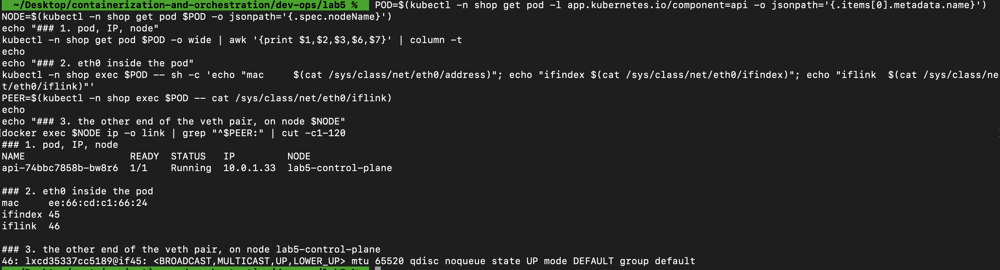
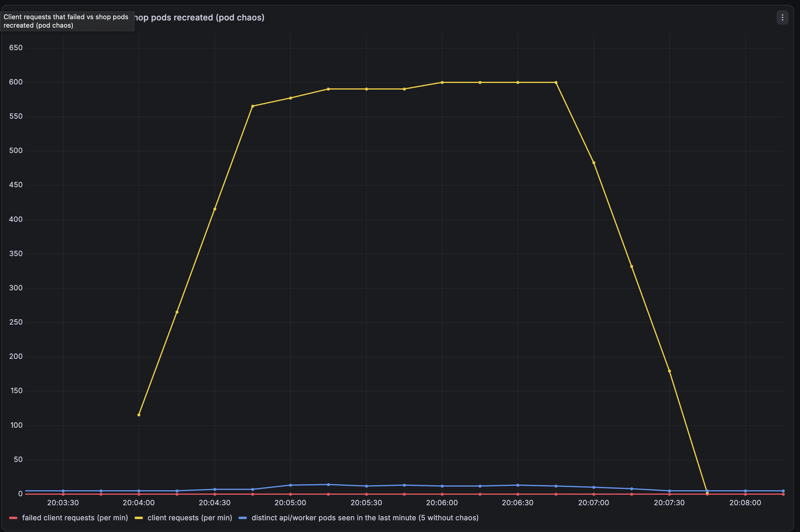
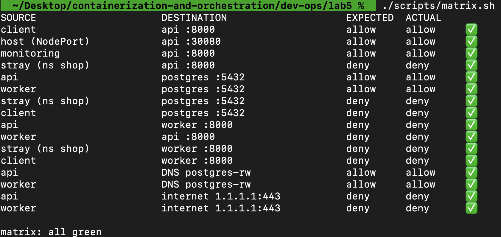
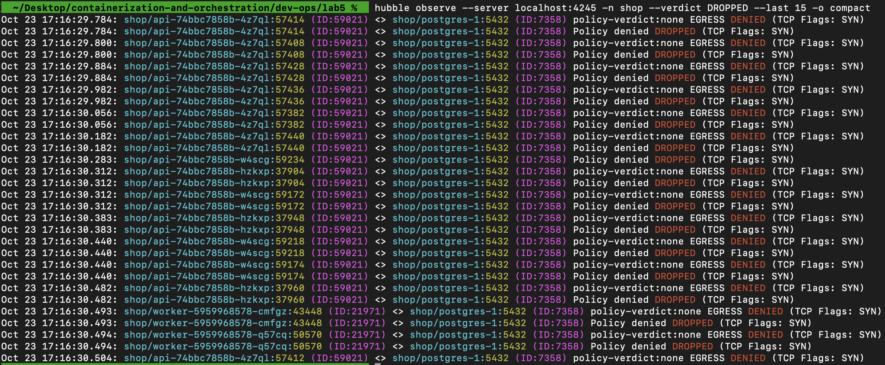
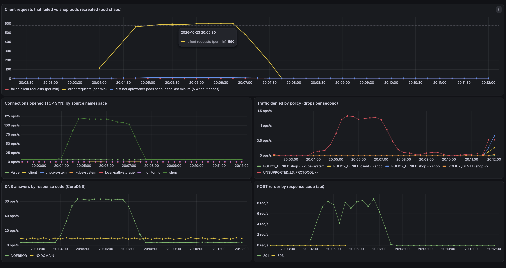

# Lab 5 — Zero-trust сеть с доказательством

`shop` из Lab 3 (api, worker, CloudNativePG postgres) на новом kind-кластере `lab5` с Cilium. Мониторинг — тот же `kube-prometheus-stack` и тот же values-файл, что в Lab 2. Новых сервисов нет. NetworkPolicy, NodePort и мониторинг — шаблоны chart `charts/shop`.

## Запуск

```bash
cd dev-ops/lab5
./scripts/up.sh      # останавливает узлы lab2 (docker start lab2-control-plane lab2-worker вернёт их), kind lab5, Cilium, мониторинг, CNPG, shop
./scripts/matrix.sh  # матрица доступа ожидание/факт
./scripts/load.sh    # k6 из ns client по DNS-имени api.shop.svc
./scripts/chaos.sh   # убивает случайный api/worker каждые 5 с
./scripts/fault.sh   # скрытый дефект (Part 6); fault.sh reveal / reset
```

Доступ: NodePort `curl http://localhost:30080/health`; Grafana `kubectl -n monitoring port-forward svc/kube-prometheus-stack-grafana 3000:80` (admin/admin); Prometheus `…-prometheus 9090:9090`; Hubble `kubectl -n kube-system port-forward svc/hubble-relay 4245:80` и `hubble observe --server localhost:4245`.

Отличия chart от Lab 4: убраны batch, PDB, PriorityClass и spreading; api и worker ходят в БД по имени `postgres-rw` (раньше по ClusterIP), поэтому DNS реально стоит на пути заказа.

## Part 0 — CNI

Выбран **Cilium**. Стандартный kindnet принимает NetworkPolicy, но не применяет их. Cilium применяет политики в eBPF, а Hubble даёт карту трафика: для каждого пакета видно `источник → цель:порт`, вердикт и причину (`Policy denied`). Это нужно для Part 6. Метрики Hubble (`hubble_drop_total`, `hubble_tcp_flags_total`) закрывают Part 7 без отдельных экспортеров. Calico тоже применяет политики, но для карты трафика ему нужны дополнительные инструменты.

`kubeProxyReplacement: false`: kube-proxy остаётся и работает в режиме `iptables` (`kubectl -n kube-system get cm kube-proxy` → `mode: iptables`). Cilium: `routing-mode=tunnel`, `tunnel-protocol=vxlan`, `ipam=cluster-pool`.

## Part 1 — как под получает сеть

Кластер из 2 нод, обе планируемые (taint с control-plane снят). IP пода, его `eth0` изнутри и парный конец veth на ноде:

```bash
POD=$(kubectl -n shop get pod -l app.kubernetes.io/component=api -o jsonpath='{.items[0].metadata.name}')
kubectl -n shop get pod $POD -o wide
kubectl -n shop exec $POD -- sh -c 'cat /sys/class/net/eth0/address /sys/class/net/eth0/ifindex /sys/class/net/eth0/iflink'
docker exec lab5-control-plane ip -o link | grep '^24:'      # 24 = iflink из предыдущей команды
```

```
api-74bbc7858b-d8h9n   1/1   Running   10.0.1.177   lab5-control-plane
56:41:66:6a:ea:7c       # eth0 в поде
23                      # ifindex eth0
24                      # iflink: индекс парного интерфейса
24: lxc54f890979484@if23: <BROADCAST,MULTICAST,UP,LOWER_UP> mtu 65520 ...   # на ноде, ссылается обратно на eth0 (23)
```

Каждой ноде IPAM Cilium (cluster-pool) выдаёт свой /24 (control-plane `10.0.1.0/24`, worker `10.0.0.0/24`), поду выдаётся адрес из него. Поды на разных нодах видят друг друга напрямую по IP, трафик идёт через VXLAN-туннель без NAT. Проверка (под `netdemo` на control-plane, api-под на worker):

```bash
kubectl -n client run netdemo --image=nicolaka/netshoot --restart=Never --overrides='{"spec":{"nodeName":"lab5-control-plane"}}' --command -- sleep 3600
kubectl -n client exec netdemo -- ip route get 10.0.0.97
kubectl -n client exec netdemo -- curl -s -o /dev/null -w "HTTP %{http_code}\n" http://10.0.0.97:8000/health
```

```
10.0.0.97 via 10.0.1.128 dev eth0 src 10.0.1.223      # шлюз = cilium_host своей ноды
HTTP 200
```

`ping` до этого пода не проходит (100% потерь): порт api открыт только для TCP 8000, ICMP политика не пропускает, это уже zero trust.

## Part 2 — непрерывность при убийстве подов

**NodePort, LoadBalancer, headless.** `NodePort` открывает на каждой ноде один и тот же порт (30080), kube-proxy перенаправляет его на endpoints Service; в kind порт проброшен на хост (`extraPortMappings`). `LoadBalancer` — это NodePort плюс внешний балансировщик облака, который сам получает внешний адрес (в kind его нет). `headless` (`clusterIP: None`) не даёт виртуального IP и kube-proxy не участвует: DNS возвращает адреса самих подов, балансировку делает клиент.

**Эксперимент.** `scripts/chaos.sh` каждые 5 с удаляет случайный под api или worker; параллельно `scripts/load.sh` — k6 из namespace `client` на `http://api.shop.svc:8000` (по DNS-имени Service, не по IP пода), 10 запросов/с, 3 минуты.

```
pods deleted: 27
requests: 1801   error_rate: 0   p95: 40 ms      # k6, SLA summary
```

За 140 секунд убито 27 подов, все пересозданы с новыми именами и IP, клиент не получил ни одной ошибки. График — дашборд Grafana **Shop Network**, панель «Client requests that failed vs shop pods recreated»: линия «failed client requests» остаётся на нуле, а «distinct api/worker pods seen in the last minute» поднимается с 5 до ~15.

**Почему это работает.**
- **DNS** (CoreDNS) превращает `api.shop.svc` в стабильный ClusterIP Service; клиент знает только имя.
- **Service** даёт этот стабильный виртуальный IP и селектор по label'ам.
- **EndpointSlice** — актуальный список IP Ready-подов; контроллер обновляет его при каждом создании/удалении пода, а нового пода там нет, пока не пройдёт readiness-проба.
- **kube-proxy** на каждой ноде превращает список в iptables-правила DNAT (`KUBE-SVC-… → KUBE-SEP-…`) со случайным выбором.
- В chart добавлен `preStop: sleep 5` у api: после SIGTERM под ещё несколько секунд принимает соединения, пока kube-proxy убирает его из правил. Без этого запрос, выбравший уже умирающий под, мог бы упасть.

**Режим kube-proxy.** `iptables`. Правила — линейные цепочки: на каждый Service десятки правил, поиск — перебором, при изменении endpoints переписывается большая часть таблицы. `IPVS` использует хеш-таблицы ядра и поиск за O(1), быстрее применяет изменения и умеет разные алгоритмы балансировки. Разница заметна, когда Service'ов тысячи и endpoints часто меняются; на кластере из нескольких Service незаметна.

**NodePort с хоста.** Service api: `externalTrafficPolicy: Local`. С `Cluster` часть запросов с хоста (запрос из Docker-проброса, попавший на под другой ноды) терялась на оверлее: 12 из 20 успехов с политиками и без них. С `Local` NodePort отдаёт запрос только поду на той же ноде, второго прыжка нет, и клиентский IP сохраняется: 30 из 30. Нагрузка из ns `client` идёт через ClusterIP и от этого не зависит.

## Part 3 — целевая матрица доступа

| Откуда → куда | Порт | Должно быть |
|---|---|---|
| client (ns `client`) → api | 8000 | разрешено |
| внешний мир (NodePort на хосте) → api | 8000 | разрешено |
| Prometheus (ns `monitoring`) → api | 8000 | разрешено (метрики) |
| api → postgres | 5432 | разрешено |
| worker → postgres | 5432 | разрешено |
| все поды shop → kube-dns | 53 UDP/TCP | разрешено |
| CNPG-оператор (ns `cnpg-system`) → postgres | 8000 | разрешено (без него оператор теряет инстанс) |
| postgres → kube-apiserver | 6443 | разрешено (instance manager CNPG) |
| случайный pod (stray) → postgres | 5432 | **запрещено** |
| stray → api; stray → worker | 8000 | запрещено |
| client → postgres; client → worker | | запрещено |
| api → worker; worker → api | 8000 | запрещено |
| api, worker → интернет | 443 | запрещено |

Пробы kubelet Cilium пропускает по умолчанию (трафик локальной ноды), отдельного правила не нужно.

## Part 4 — NetworkPolicy в chart

`charts/shop/templates/networkpolicy.yaml`, все labels, namespace'ы, порты и флаги — в блоке `networkPolicy:` файла `values.yaml`.

1. `default-deny`: `podSelector: {}`, Ingress+Egress — всё закрыто.
2. `allow-dns-egress`: все поды shop → `kube-system`, `k8s-app=kube-dns`, порт 53.
3. `api-ingress`: на 8000 только из namespace'ов `client` и `monitoring`.
4. `api-egress-postgres`, `worker-egress-postgres`: egress на поды `cnpg.io/cluster=postgres`, порт 5432.
5. `postgres-ingress`: 5432 от api и worker (по labels), 8000 от namespace `cnpg-system`.
6. Два `CiliumNetworkPolicy`: вход NodePort в api (`fromEntities: world, host, remote-node`) и `postgres → kube-apiserver` (`toEntities: kube-apiserver`). Обычная NetworkPolicy не умеет описывать трафик с идентичностью ноды или API-сервера, поэтому здесь нужен CRD Cilium.

## Part 5 — матрица на практике

`./scripts/matrix.sh` создаёт временные поды-источники (client, stray, monitoring) и из каждого источника проверяет TCP-подключение (таймаут 3 с):

```
SOURCE                     DESTINATION                    EXPECTED  ACTUAL
client                     api :8000                      allow     allow     ✅
host (NodePort)            api :30080                     allow     allow     ✅
monitoring                 api :8000                      allow     allow     ✅
stray (ns shop)            api :8000                      deny      deny      ✅
api                        postgres :5432                 allow     allow     ✅
worker                     postgres :5432                 allow     allow     ✅
stray (ns shop)            postgres :5432                 deny      deny      ✅
client                     postgres :5432                 deny      deny      ✅
api                        worker :8000                   deny      deny      ✅
worker                     api :8000                      deny      deny      ✅
stray (ns shop)            worker :8000                   deny      deny      ✅
client                     worker :8000                   deny      deny      ✅
api                        DNS postgres-rw                allow     allow     ✅
worker                     DNS postgres-rw                allow     allow     ✅
api                        internet 1.1.1.1:443           deny      deny      ✅
worker                     internet 1.1.1.1:443           deny      deny      ✅

matrix: all green
```

Случайный pod больше не подключается к PostgreSQL, а api и worker подключаются.

**Контроль.** Чтобы убедиться, что зелёные `deny` вызваны именно политиками, а не сломанной сетью, я отключил их и прогнал ту же матрицу:

```bash
helm upgrade shop charts/shop -n shop --reset-values --set networkPolicy.enabled=false
./scripts/matrix.sh        # matrix: MISMATCH
helm upgrade shop charts/shop -n shop --reset-values
```

Без политик (0 объектов NetworkPolicy в `shop`) девять запретов превращаются в `allow`: stray → api, stray → postgres, client → postgres, api → worker, worker → api, stray → worker, client → worker, api → интернет, worker → интернет. Разрешённые маршруты остаются зелёными. После возврата политик матрица снова `all green`.

## Part 6 — скрытый обрыв

`scripts/fault.sh` выбирает случайный из четырёх дефектов и применяет его через `helm upgrade --set` по values, не называя его: неверный label в allow для postgres, порт в политиках не совпадает с портом Service, выключен DNS-egress, убрано egress-правило api → postgres. Имя дефекта сохраняется в `scripts/.fault`.

Каждый из четырёх дефектов проверен: все ломают заказы, но по-разному.

| Дефект | Симптом `POST /order` | Что показывает Hubble |
|---|---|---|
| `wrong-label` (allow-правило postgres выбирает api по несуществующему label) | `503` за ~3 с | дропы api → postgres:5432 на входе postgres; worker проходит |
| `wrong-port` (политики открывают 5433 при Service на 5432) | `503` за ~3 с | дропы и api, и worker → postgres:5432 |
| `no-dns` (убрано разрешение DNS) | ответа нет, таймаут (>6 с) | `EGRESS DENIED (UDP)` от подов shop к `kube-system/coredns:53` |
| `no-api-egress` (убран egress api → postgres) | `503` за ~3 с | `EGRESS DENIED` api → postgres:5432; worker проходит |

**Диагностика (пример: `no-api-egress`).**
1. Симптом: `POST /order` отвечает `503` за ~3 секунды (`curl` на NodePort; три из трёх запросов). Это похоже на таймаут подключения к БД, а не на ошибку приложения.
2. Hubble, `hubble observe -n shop --verdict DROPPED`: повторяются `shop/api-… <> shop/postgres-1:5432 policy-verdict:none EGRESS DENIED` и `Policy denied DROPPED (TCP Flags: SYN)`. Пакет отбрасывается на **egress api**: на стороне postgres (ingress) вердиктов нет, DNS отвечает (имя разрешилось, поток дошёл до стадии подключения). Значит, не DNS и не правило входа postgres.
3. `kubectl -n shop get netpol`: есть `worker-egress-postgres`, **нет** `api-egress-postgres`. Значит, в values выключено правило egress api → postgres (`networkPolicy.api.egressToPostgres`).
4. Исправление: вернуть значение в `values.yaml` (`true`), `helm upgrade`. `matrix.sh` снова зелёный.
5. Сверка: `./scripts/fault.sh reveal` → `no-api-egress: the egress rule api -> postgres is removed`.

**Второй пример: `no-dns`.**
1. Симптом: `POST /order` не отвечает вовсе (`HTTP 000`, таймаут больше 8 с), а не `503`: приложение зависает ещё до обращения к БД.
2. Hubble, `hubble observe -n shop --verdict DROPPED`: сотни `shop/api-… <> kube-system/coredns-…:53 policy-verdict:none EGRESS DENIED` и `Policy denied DROPPED (UDP)`. Потоков api → postgres в дропах нет: до БД дело не доходит, api не может разрешить имя `postgres-rw`.
3. `kubectl -n shop get netpol`: нет `allow-dns-egress`.
4. Сверка: `./scripts/fault.sh reveal` → `no-dns`; после `./scripts/fault.sh reset` заказы снова `HTTP 201` за 70–90 мс, `matrix.sh` `all green`.
5. Во время поломки в состоянии `firing` стояли `ShopPolicyDrops`, `ShopDnsFailures` и `ShopApiErrorRate`: за 2 минуты около 8940 отброшенных UDP-пакетов из `shop`, доля 5xx у api 78%.

## Part 7 — мониторинг

В chart (`templates/monitoring.yaml`): ServiceMonitor api, ServiceMonitor `hubble-metrics` (Cilium), PrometheusRule с тремя алертами и дашборд **Shop Network**. Hubble включён с `labelsContext=source_namespace,destination_namespace`, поэтому метрики можно отфильтровать по namespace. Стек — Lab 2, ставится тем же values-файлом.

| Alert | Условие | Зачем |
|---|---|---|
| `ShopPolicyDrops` | `hubble_drop_total{reason="POLICY_DENIED"}` вырос для namespace `shop`, 30 с | какая-то политика режет трафик shop: сломан allow-маршрут или кто-то лезет туда, куда нельзя |
| `ShopDnsFailures` | >5% ответов CoreDNS — `SERVFAIL`/`REFUSED`, **или** UDP-трафик подов shop отбрасывается политикой, 30 с | без DNS сервисы не находят друг друга (api не разрешает `postgres-rw`); второе условие ловит случай, когда запросы не доходят до CoreDNS |
| `ShopApiErrorRate` | >5% ответов api — 5xx, 30 с | заказы не проходят; видимый симптом большинства обрывов |

Дашборд: график непрерывности (Part 2), соединения (TCP SYN) по namespace, отброшенный политикой трафик по причинам и направлениям, ответы DNS по rcode, `POST /order` по кодам.

Зажигание: `ShopPolicyDrops` переходит в `firing` при прогоне `matrix.sh` (запрещённые обращения stray/client считаются отброшенными пакетами) и при любом из дефектов Part 6. При дефекте `no-dns` одновременно горит `ShopDnsFailures`: SERVFAIL в CoreDNS при этом нет, запросы режутся политикой до него, и сработало второе условие алерта. Метрики DNS взяты из CoreDNS (стек Lab 2), а не из Hubble: в этой установке DNS-метрик Hubble нет, для них нужна L7-политика DNS, а лабе она не требуется.

## Скриншоты

**01 — сеть пода (Part 1).** У api-пода `eth0` с `ifindex 45` и `iflink 46`; на ноде интерфейс `46: lxc…@if45` — парный конец veth.



**02 — непрерывность при хаосе (Part 2).** Клиентские запросы идут около 600 в минуту, неуспешных 0, пока api и worker пересоздаются (синяя линия).



**03 — матрица доступа (Part 5).** Все 16 проверок совпали с ожиданием, итог `matrix: all green`.



**04 — карта трафика с найденной блокировкой (Part 6).** Hubble показывает `EGRESS DENIED / Policy denied DROPPED` для api и worker → `postgres-1:5432`: режется исходящий трафик к БД.



**05 — дашборд Shop Network (Part 7).** Непрерывность, соединения, отброшенный политикой трафик, ответы DNS и `POST /order` по кодам.


