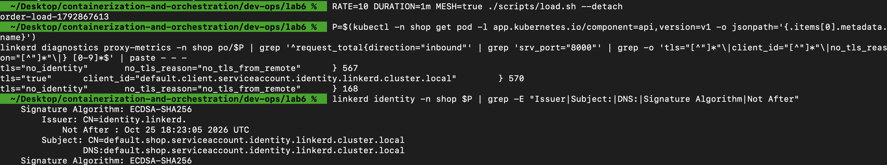
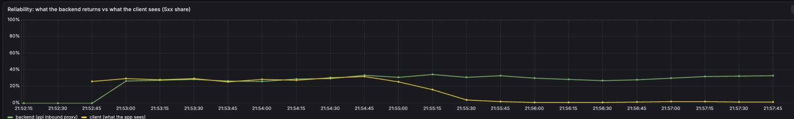
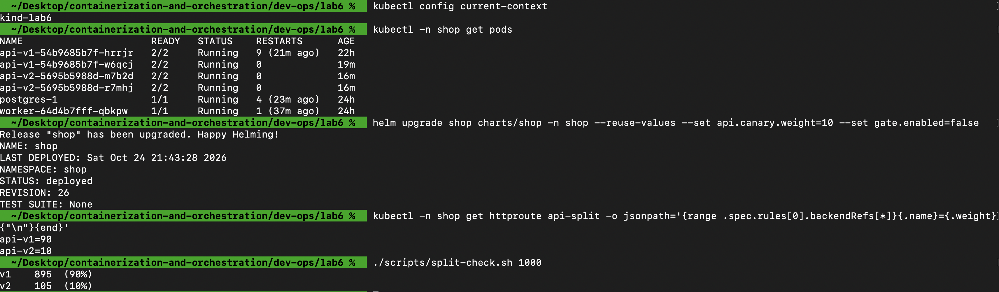
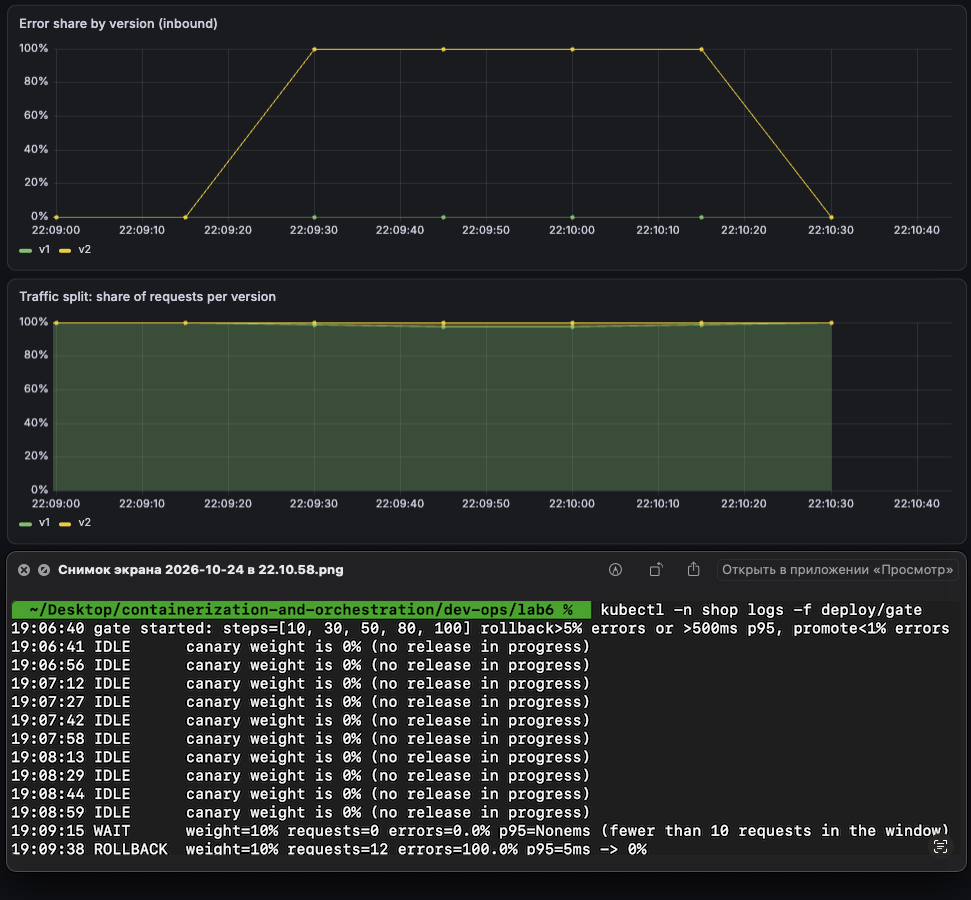
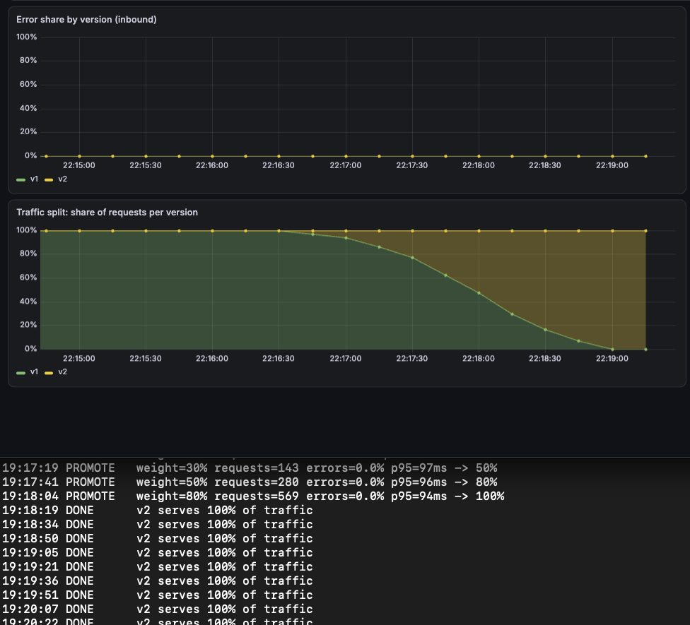
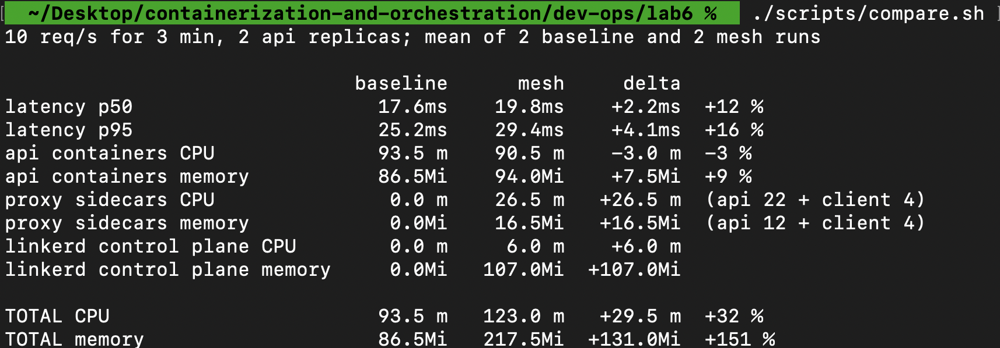
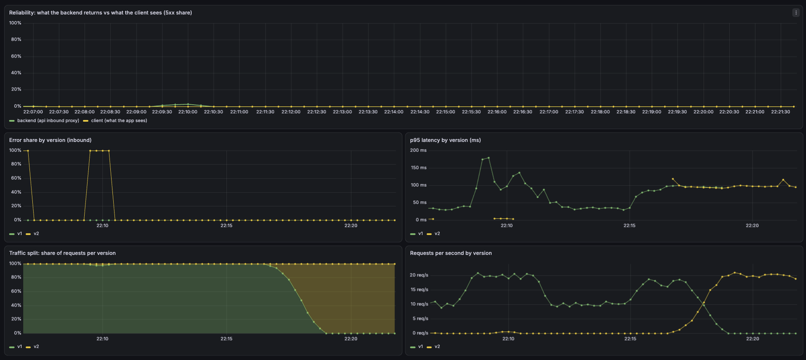

# Lab 6 — Автопилот релиза: катит хорошее, откатывает плохое

`api` из chart `shop` (Lab 5) на одноузловом kind-кластере `lab6`: сначала замер без mesh, затем Linkerd (mTLS, retries), деление трафика v1/v2, скрипт-гейт, который сам откатывает плохую версию и докатывает хорошую, и подсчёт цены mesh. Мониторинг — тот же `kube-prometheus-stack` и тот же values-файл, что в Lab 2. Версии, split, mesh-аннотации, гейт, ServiceMonitor/PodMonitor/PrometheusRule и дашборд — шаблоны chart `charts/shop`.

## Запуск

```bash
cd dev-ops/lab6
./scripts/up.sh          # kind lab6, стек Lab 2, CNPG, shop: только v1, без mesh (baseline)
./scripts/measure.sh baseline      # Part 2
./scripts/mesh-up.sh     # Linkerd (Part 3)
helm upgrade shop charts/shop -n shop --reuse-values --set mesh.enabled=true   # поды api перезапускаются уже с sidecar
```

Дальше всё через `helm upgrade --reuse-values` (команды в частях ниже). `values.yaml` описывает финальное состояние (mesh, retries, circuit breaker, v2 и гейт включены, вес v2 = 0); `up.sh` ставит baseline явными флагами «без mesh». Скрипты: `load.sh` (k6 из ns `client`), `measure.sh`, `compare.sh`, `split-check.sh`, `release.sh`.

## Part 0 — сервисы

`api/main.py` (одна кодовая база, версия задаётся env):
- `GET /version` возвращает `v1` или `v2`, `GET /health`, `POST /order`, `GET /orders`;
- `FAIL=true` (v2): каждый `POST /order` отвечает 500;
- `FLAKY=true` с `FLAKY_RATE=0.3` (v1): 30% запросов `POST /order` падают с 500. Отказ случается до записи в БД, поэтому повторённый запрос не создаёт дубль заказа.

Скрипт-гейт — `gate/gate.py` (логика в Part 6), образ `gate/Dockerfile` (Python + helm + копия chart).

## Part 1 — выбор mesh

Выбран **Linkerd**.
- Ставится одной командой, сертификаты и trust anchor создаёт сам.
- Прокси добавляется только подам с аннотацией `linkerd.io/inject: enabled`: mesh буквально включается там, где этого хочет chart (`mesh.enabled` в values).
- Retries, circuit breaking и split — аннотации на Service и объект `HTTPRoute` (Gateway API), то есть весь «код» mesh лежит в шаблонах chart; метрики прокси (`response_total`, `response_latency_ms`) уже содержат версию, статус и identity клиента.
- Istio ambient не выбран: L4 и mTLS у него без sidecar'ов, но retries и split требуют waypoint-прокси (Envoy) и дополнительных компонентов, что тяжелее для ноутбука.

Две оговорки:
- Образы, которые ждёт CLI из Homebrew (`version-2.20`), в реестре не опубликованы, поэтому control plane ставится на опубликованный `edge-26.9.3` (`scripts/mesh-up.sh`).
- В Linkerd retries, split и клиентская сторона mTLS выполняются прокси **вызывающего** пода. Поэтому в mesh вместе с `api` находится и тестовый клиент (поды k6 и `curl` в namespace `client`). Остальной `shop` (postgres, worker) вне mesh.

## Part 2 — baseline без mesh

v1 (2 реплики) и postgres, без mesh. `./scripts/measure.sh baseline`: k6, 10 запросов/с, 3 минуты, затем CPU и память из Prometheus за то же окно. Два прогона:

| | прогон 1 | прогон 2 |
|---|---|---|
| запросов, ошибок | 1800, 0% | 1801, 0% |
| задержка p50 / p95 | 17,6 / 25,1 мс | 17,7 / 25,3 мс |
| контейнеры `api` (CPU, память) | 92m, 86 MiB | 95m, 87 MiB |

Точка отсчёта для Part 8. Результаты лежат в `measurements/baseline-*.txt`.

## Part 3 — mesh и mTLS

`mesh.enabled: true` в values вешает `linkerd.io/inject: enabled` на поды `api`; namespace `client` включается в mesh тем же переключателем в `load.sh` (`MESH=true`). Поды api получают `linkerd-init` и `linkerd-proxy` (native sidecar).

**1. Identity из сертификата, а не по IP.** Метрики inbound-прокси api:

```
$ linkerd diagnostics proxy-metrics -n shop po/<api-под> | grep 'request_total{direction="inbound"'
tls="true",client_id="default.client.serviceaccount.identity.linkerd.cluster.local",srv_port="8000"      263
tls="no_identity",no_tls_reason="no_tls_from_remote",srv_port="8000"                                     26
```

Запросы k6 приходят с `tls="true"` и `client_id` = ServiceAccount `default` в `client`: прокси проверил клиентский сертификат. Запросы без сертификата (пробы kubelet и скрейп метрик Prometheus, оба вне mesh) помечены `no_identity`, клиентов приложения среди них нет.

**2. На проводе шифрование.** В сетевом namespace пода api (эфемерный контейнер от root через `kubectl debug`, `tcpdump -A -i eth0`): клиент без mesh и meshed-клиент (k6) одновременно.

```
клиент без mesh -> порт 8000:  55 пакетов, читается открытым текстом: "POST /order" и тело запроса
meshed-клиенты  -> порт 4143: 114 пакетов, "POST /order" внутри: 0 (нечитаемый поток TLS)
```

**3. Сертификат пода.**

```
$ linkerd identity -n shop <api-под>
Issuer: CN=identity.linkerd.
Subject: CN=default.shop.serviceaccount.identity.linkerd.cluster.local
X509v3 Subject Alternative Name: DNS:default.shop.serviceaccount.identity.linkerd.cluster.local
Signature Algorithm: ECDSA-SHA256, срок действия 24 часа
```

Сертификат выдан `identity.linkerd` (trust anchor control plane) и называет ServiceAccount пода, а не его IP.



*Рис. 1. Запросы к `api` приходят с `tls="true"` и identity ServiceAccount клиента; сертификат пода выдан `identity.linkerd` и называет ServiceAccount.*

## Part 4 — надёжность бесплатно

Настройка только в chart, код `api` не менялся:
- v1: `FLAKY=true`, `FLAKY_RATE=0.3`;
- на Service `api` (его использует клиент): `retry.linkerd.io/http: 5xx`, `retry.linkerd.io/limit: 3` и `balancer.linkerd.io/failure-accrual: consecutive` (7 подряд);
- retries включаются в середине прогона отдельным `helm upgrade --set mesh.retries.enabled=true`, остальное не меняется.

Прогон: 6 минут по 10 запросов/с, retries включены на 150-й секунде. Доли 5xx по 30-секундным окнам:

| этап | retries | backend (inbound прокси api) | клиент (outbound прокси) | попыток на запрос клиента |
|---|---|---|---|---|
| первые 150 с | выкл | 27–34% | 24–33% | 1,00 |
| после 150 с | **вкл** | 27–34% | **0–1,3%** | 1,33–1,44 |

Backend отдаёт около 30% ошибок на протяжении всего прогона, а клиент после включения retries видит 0–1,3%. График — панель «Reliability» дашборда Shop Mesh.



*Рис. 2. `FLAKY=true`: backend отдаёт около 30% ошибок на всём графике, у клиента они пропадают после включения retries.*

**Какой механизм сработал: retries, а не circuit breaking.** По метрикам клиентского прокси:
- счётчики retries: `outbound_http_route_retry_requests_total` = 935 повторных попыток, `outbound_http_route_retry_successes_total` = 669 успешных; `..._limit_exceeded_total` = 15 (лимит в 3 попытки исчерпан), `..._overflow_total` = 0;
- попыток на запрос выросло с 1,00 до 1,33–1,44 (`backend_response_statuses_total / request_statuses_total`), что близко к ожидаемым 1/(1−0,3) ≈ 1,43;
- circuit breaker не срабатывал: `outbound_http_balancer_endpoints{endpoint_state="ready"}` всё время равен 2 (оба endpoint'а в балансировке), `pending` равен 0. Breaker включён на нужном Service, но случайные 30% ошибок почти не дают 7 отказов подряд на одном endpoint'е.

Цена: нагрузка на backend растёт примерно на 33–44% из-за лишних попыток.

## Part 5 — v1 и v2, деление 90/10

`api.versions.v1/v2` в values: на каждую версию Deployment, Service (`api-v1`, `api-v2`) и label `version`. Split — `templates/split.yaml`: HTTPRoute с родителем Service `api` и весами `api-v1: 90`, `api-v2: 10` (`api.canary.weight` = доля v2 в процентах).

`./scripts/split-check.sh N` делает N запросов `GET /version` по имени `api.shop.svc` из meshed-пода и считает ответы (поду нужен sidecar, потому что split выполняет прокси клиента):

```
200 запросов:   v1 185 (92%)   v2 15 (8%)
1000 запросов:  v1 889 (89%)   v2 111 (11%)
```



*Рис. 3. Вес в HTTPRoute 90/10; 1000 запросов `GET /version` дали v1 895 (90%) и v2 105 (10%).*

## Part 6 — автопилот

`gate/gate.py` работает в кластере (Deployment `gate`, включается `gate.enabled`). Раз в 15 секунд:

1. Читает текущий вес v2 из релиза (`helm get values`). Вес 0 — релиза нет, гейт ждёт; вес 100 — релиз завершён.
2. Берёт из Prometheus метрики **inbound-прокси подов v2** за последнюю минуту, только запросы клиентов с identity (`tls="true"`, порт 8000): число запросов, долю ответов с `classification="failure"` и p95 `response_latency_ms`.
3. Принимает решение:
   - запросов меньше 10 за окно — **ждать** (данных мало; порог низкий, потому что circuit breaker быстро выводит сломанные поды v2 из балансировки и запросов к ним становится мало);
   - ошибок больше 5% или p95 больше 500 мс — **откатить**: `helm upgrade --set api.canary.weight=0`, v2 больше не получает трафик;
   - ошибок меньше 1% (и p95 в норме) — **докатить на шаг**: 10 → 30 → 50 → 80 → 100%;
   - ошибки между 1% и 5% — **держать** текущий вес.

Гейт меняет вес только через `helm upgrade --reuse-values` по chart, поэтому состояние остаётся в values релиза, а не в kubectl-патчах. Пороги и шаги — значения `gate.*`.

Выкатка релиза делается в два шага (`scripts/release.sh`): сначала поды v2 заменяются при весе 0, затем канарейка открывается на 10%. Так в окне гейта не оказывается ответов старых подов.

## Part 7 — оба сценария

Под постоянной нагрузкой k6 (10 запросов/с), `scripts/release.sh bad|good`.

**1. Плохой релиз (`FAIL=true`).** Гейт откатил сам:

```
19:43:35 WAIT      weight=10% requests=0  errors=0.0%   (меньше 20 запросов)
19:43:51 WAIT      weight=10% requests=16 errors=100.0% (меньше 20 запросов)
19:44:14 ROLLBACK  weight=10% requests=24 errors=100.0% p95=3ms -> 0%
```

Через 52 секунды после выкатки вес v2 вернулся в 0%. Доля ошибок v2 была 100%, а клиент всё время видел 0% ошибок (retries перенаправляли отказы на v1). Именно такой случай ловит алерт `ShopBackendFailuresHidden`.



*Рис. 4. Плохая v2 (`FAIL=true`): ошибки v2 доходят до 100%, гейт пишет `ROLLBACK … -> 0%` через 23 секунды после открытия 10%.*

На графике «Traffic split» доля v2 здесь почти не видна (около 2–3%): circuit breaker сам выводит сломанные поды v2 из балансировки, и реальный трафик к ним мал. Сигнал отката здесь — доля ошибок v2 и строка `ROLLBACK`.

**2. Хороший релиз (`FAIL=false`).** Гейт довёл до 100%:

```
19:55:27 WAIT      weight=10% requests=15  errors=0.0%
19:55:50 PROMOTE   weight=10% requests=40  errors=0.0% p95=38ms -> 30%
19:56:12 PROMOTE   weight=30% requests=80  errors=0.0% p95=33ms -> 50%
19:56:34 PROMOTE   weight=50% requests=144 errors=0.0% p95=29ms -> 80%
19:56:56 PROMOTE   weight=80% requests=353 errors=0.0% p95=32ms -> 100%
19:57:12 DONE      v2 serves 100% of traffic
```

Хронология (Prometheus, окно 30 с): доля трафика v2 прошла 0 → 14% → 37% → 48% → 66% → 86% → 100%, доля ошибок v2 и клиента всё время 0%. Графики обоих сценариев — панели «Traffic split» и «Error share by version» дашборда Shop Mesh.



*Рис. 5. Здоровая v2: гейт сам прошёл 10→30→50→80→100% (`PROMOTE`, затем `DONE`), доля ошибок v2 всё время 0%.*

## Part 8 — цена mesh и вердикт

Тот же замер (`MESH=true ./scripts/measure.sh mesh`, два прогона), та же конфигурация: только v1, 2 реплики, 10 запросов/с, 3 минуты. `./scripts/compare.sh` усредняет по два прогона:

| | baseline | mesh | разница |
|---|---|---|---|
| задержка p50 | 17,6 мс | 19,8 мс | **+2,2 мс (+12%)** |
| задержка p95 | 25,2 мс | 29,4 мс | **+4,1 мс (+16%)** |
| CPU контейнеров `api` | 93,5m | 90,5m | в пределах шума |
| память контейнеров `api` | 86,5 MiB | 94,0 MiB | +7,5 MiB |
| прокси-sidecar'ы (CPU) | 0 | 26,5m (api 22m + клиент 4m) | +26,5m |
| прокси-sidecar'ы (память) | 0 | 16,5 MiB (api 12 + клиент 4) | +16,5 MiB |
| control plane Linkerd (CPU) | 0 | 6m | +6m |
| control plane Linkerd (память) | 0 | 107 MiB | +107 MiB |
| **всего CPU** | 93,5m | 123m | **+29,5m (+32%)** |
| **всего память** | 86,5 MiB | 217,5 MiB | **+131 MiB (+151%)** |



*Рис. 6. Baseline и mesh на одной нагрузке: +2,2 мс p50, +4,1 мс p95, +32% CPU и +151% памяти в сумме.*

**Вердикт.** Задержка почти не страдает: +2 мс на медиане и +4 мс на p95 при общей задержке около 20–30 мс. Основная цена — ресурсы: один прокси стоит около 11m CPU и 6 MiB на под, а control plane (107 MiB) один потребляет больше памяти, чем весь `api` (87 MiB), то есть для одного сервиса и одной ноды накладные расходы кратно превышают полезную нагрузку.

Для системы такого размера (один сервис в mesh, 2 реплики, 10 запросов/с) постоянный mesh **не оправдан** ради одного mTLS или retries: оба решаются дешевле (TLS на уровне приложения или ingress, повтор запроса в клиенте). Оправдан он здесь ровно в той части, которая в лабе и строилась: канареечный релиз. Взвешенный split и метрики по версиям дают гейту всё нужное без изменений в `api`, и только так видно, что плохая v2 отдаёт 100% ошибок при 0% ошибок у клиента. С ростом числа сервисов цена за сервис падает (control plane фиксирован, на каждый под добавляется около 11m и 6 MiB), так что вердикт «не оправдан» относится именно к одному сервису.

## Part 9 — мониторинг

В chart (`templates/monitoring.yaml`): ServiceMonitor метрик `api`, PodMonitor прокси Linkerd (namespace `shop` и `client`, метка `version` берётся с пода), PrometheusRule с тремя алертами и дашборд **Shop Mesh**. Стек Lab 2, `linkerd-viz` не ставится.

| Alert | Условие | Зачем |
|---|---|---|
| `ShopCanaryErrorRate` | доля 5xx у v2 больше 5%, 1 мин | плохая канарейка. Это тот же сигнал, по которому действует гейт: гейт откатывает, алерт сообщает человеку, что это произошло |
| `ShopBackendFailuresHidden` | inbound-ошибки больше 10% при доле 5xx у клиента меньше 2%, 2 мин | retries скрывают от клиентов больной backend. Снаружи сервис выглядит здоровым, но каждая версия с отказами стоит лишних попыток |
| `ShopApiLatencyP95` | p95 inbound любой версии больше 500 мс, 2 мин | деградация задержки, в том числе из-за прокси и перегруженной версии |

Проверка: правила загружены в Prometheus (`health=ok`). `ShopBackendFailuresHidden` проверен в деле: при `FLAKY=true` под нагрузкой он перешёл в `firing` пока клиент почти не видел ошибок.

Дашборд: ошибки backend и клиента на одном графике (Part 4), доля ошибок и p95 по версиям, доля трафика и запросы в секунду по версиям (Part 5 и 7).



*Рис. 7. Дашборд Shop Mesh: backend против клиента, ошибки и p95 по версиям, доля трафика и запросы в секунду.*

## Скриншоты

Папка `screenshots/`; команды для кадров:

| Файл | Содержание | Как получить |
|---|---|---|
| `01-mtls-encryption.png` | шифрование и identity | метрики с `tls="true"`, `client_id` и вывод `linkerd identity` (Part 3) |
| `02-reliability-flaky.png` | backend фейлит, клиент почти нет | панель «Reliability» дашборда во время прогона с `FLAKY=true` и включением retries |
| `03-split-90-10.png` | деление трафика | `./scripts/split-check.sh 1000` |
| `04-rollback-bad-release.png` | автоматический откат плохой v2 | `./scripts/release.sh bad` + лог гейта + панели «Traffic split» и «Error share» |
| `05-promote-good-release.png` | автоматический докат хорошей v2 | `./scripts/release.sh good` + лог гейта + те же панели |
| `06-baseline-vs-mesh.png` | сравнение | `./scripts/compare.sh` |
| `07-dashboard.png` | дашборд | Grafana, Shop Mesh |
