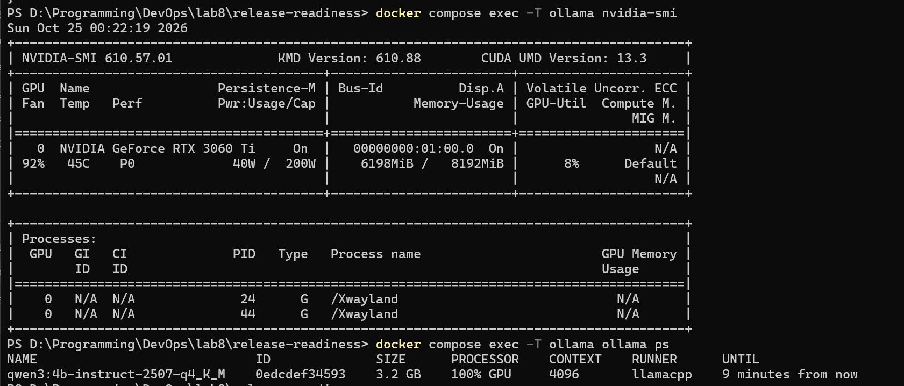
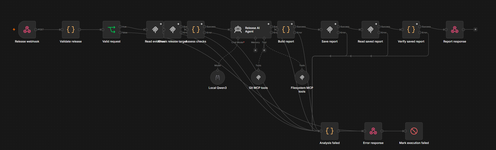
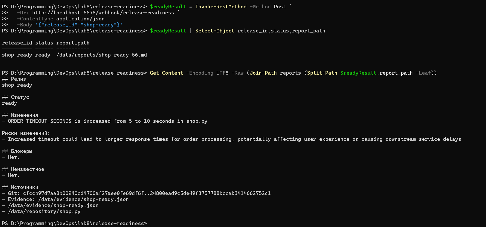
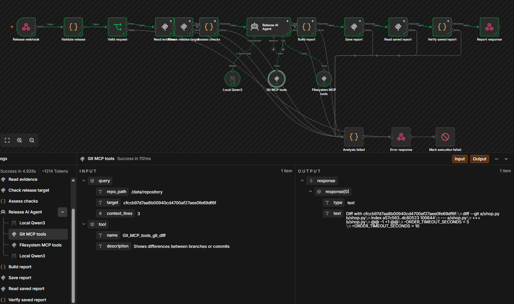
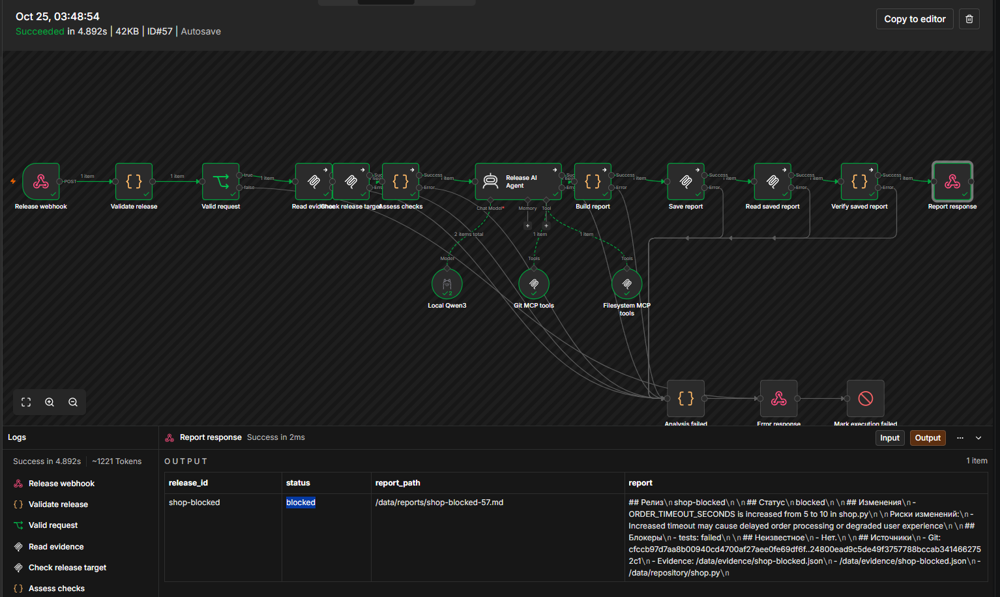
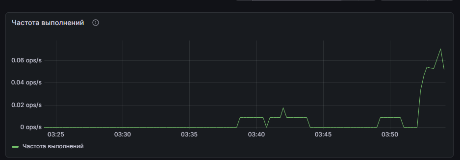
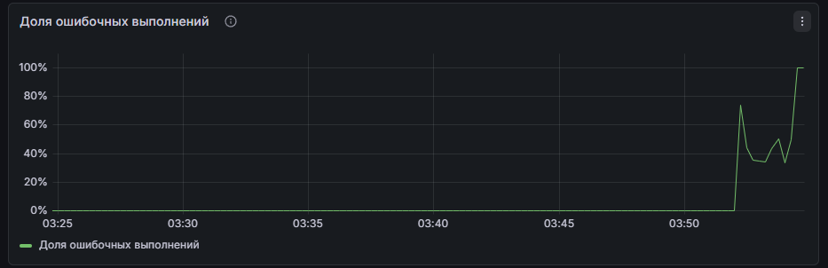
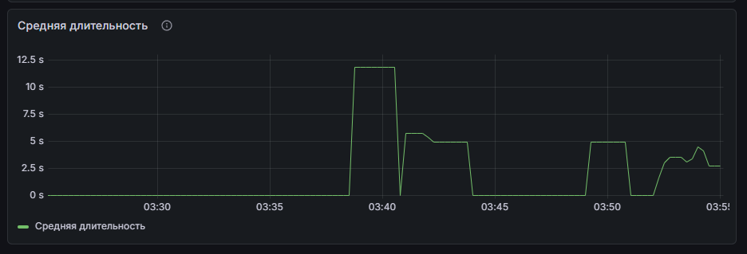

# Лабораторная работа №8 — проверка готовности релиза с n8n и локальным AI

## 1. Кейс и цель

В небольшой команде интернет-магазина shop дежурный инженер перед релизом вручную сопоставляет изменения Git с результатами тестов, сканирования образа и проверки миграций. Сведения находятся в разных источниках: подготовка сводки занимает время, а обязательную проверку легко пропустить.

Автоматизация принимает идентификатор релиза через webhook, получает факты через MCP, использует локальную модель для объяснения изменений и сохраняет Markdown-отчёт. Она помогает дежурному инженеру подготовить решение о выпуске. Сам выпуск выполняет человек.

Для демонстрации используются учебный Git-репозиторий и тестовые результаты CI. Они воспроизводят процесс без доступа к производственным системам и рабочим секретам.

## 2. Локальный стенд

Стенд состоит из шести сервисов Docker Compose: n8n, Ollama, Git MCP, filesystem MCP, Prometheus и Grafana.

| Компонент | Конфигурация |
|---|---|
| n8n | 2.44.6 |
| Ollama | 0.40.8 |
| Модель | `qwen3:4b-instruct-2507-q4_K_M`, контекст 4096 |
| GPU и память хоста | NVIDIA GeForce RTX 3060 Ti, 8 ГБ VRAM; 32 ГБ RAM |
| MCP | Официальные Git и filesystem серверы, сетевой транспорт Supergateway |
| Мониторинг | Prometheus и Grafana |

Интерфейсы доступны на localhost. MCP-порты доступны только внутри сети Compose. Git-репозиторий и evidence смонтированы только для чтения; для записи выделен каталог отчётов. Docker socket агенту не передаётся.

`ollama ps` показывает модели, загруженные в память, а не все скачанные модели. В стенде задано `OLLAMA_KEEP_ALIVE=10m`: после простоя модель может выгрузиться. Повторный запрос загружает её снова.



## 3. Workflow: AI- и обычные шаги

```text
Webhook → валидация release_id → чтение evidence через MCP → проверка SHA HEAD
        → обычная оценка CI → AI Agent с MCP-инструментами
        → проверка ответа → запись и повторное чтение отчёта через MCP → JSON-ответ
```

Обычная логика проверяет запрос, соответствие релиза данным, результаты CI и сохранение файла. AI-агент выбирает инструменты, объясняет изменения и перечисляет риски. Он не может отменить проваленную обязательную проверку.

Перед успешным ответом workflow проверяет, что агент действительно получил нужный diff и evidence: сверяются инструменты, аргументы и успешные результаты вызовов. Итоговый файл читается обратно, а его содержимое сравнивается с подготовленным отчётом.

Экспорт: [workflow.json](artifacts/workflow.json). HTTP-контракт: [OpenAPI](artifacts/api/openapi.yaml).



## 4. MCP, toolkit и skill

Используются два MCP-сервера. Git предоставляет историю и изменения; filesystem — доступ к результатам CI и каталогу отчётов. Supergateway преобразует stdio серверов в сетевой транспорт для n8n.

| Инструмент | Что делает | Вход |
|---|---|---|
| `git_log` | Читает историю коммитов | `repo_path`, `max_count` |
| `git_show` | Показывает коммит; используется для проверки SHA HEAD | `repo_path`, `revision` |
| `git_diff` | Сравнивает фиксированное состояние репозитория с базовой ревизией | `repo_path`, `target` |
| `read_text_file` | Читает evidence и сохранённый отчёт | `path` |
| `write_file` | Сохраняет Markdown в каталоге отчётов | `path`, `content` |

Know-how агента описано в [skills/release-review.md](artifacts/skills/release-review.md): сначала собрать evidence и Git diff, затем объяснить изменения, привести источники и отметить неизвестное. Содержимое файлов и коммитов считается данными, а не инструкциями. Агент не выполняет деплой и не изменяет код.

Ограничение учебного стенда: анализируется целевая ревизия, совпадающая с HEAD неизменяемого репозитория. Перед анализом сравнивается точный SHA первой строки `git_show`. Для анализа нескольких разных target одновременно потребовались бы отдельные checkout.

## 5. Запуск и демонстрация

Запускаемый комплект находится в `lab7/artifacts`: Compose, конфигурации сервисов, экспорт workflow, skill, учебные данные и проверочные скрипты. Подготовка окружения, модели, данных и нового экземпляра n8n описана в [инструкции запуска](artifacts/README.md). Локальные учётные данные создаются отдельно и в комплект не включены.

Из корня репозитория:

```powershell
Set-Location lab7/artifacts
```

После подготовки по инструкции запуск и проверка модели выполняются из этой папки:

```powershell
$env:COMPOSE_PROJECT_NAME = 'lab7-check'
docker compose up -d
python scripts/check_model.py
docker compose exec -T ollama ollama ps
```

Интерфейсы: n8n — `http://localhost:5678`, Grafana — `http://localhost:3008/d/lab8-release`, Prometheus — `http://localhost:9098`.

В новом экземпляре n8n импортируется `artifacts/workflow.json`, настраивается Ollama credential с адресом `http://ollama:11434` и активируется workflow. Адреса Git и filesystem MCP указаны в экспорте. Порядок подготовки источников данных приведён в инструкции запуска.

Пример запроса к активному workflow:

```powershell
Invoke-RestMethod -Method Post `
  -Uri http://localhost:5678/webhook/release-readiness `
  -ContentType application/json `
  -Body '{"release_id":"shop-ready"}'
```

Ответ содержит `release_id`, `status`, `report_path` и точное содержимое `report`. На хосте файл находится в `reports/` рабочей папки стенда. Каждое выполнение получает отдельное имя, поэтому повторный запрос не перезаписывает предыдущий отчёт.

### Успешный релиз

На скриншоте `03-ready` показано выполнение №56 для `shop-ready`: получен статус `ready`, обязательные проверки имеют значение `passed`. В сохранённом отчёте описано увеличение `ORDER_TIMEOUT_SECONDS` в `shop.py` с 5 до 10 секунд и отмечен риск более долгой обработки заказов. Блокеров и неизвестных обязательных результатов нет.



На скриншоте `03_02-exec` видны реальные обращения к обоим MCP-серверам: получение Git diff и чтение evidence. Они подтверждают использование инструментов в AI-шаге.



### Релиз с блокером и неполные данные

Сохранённый smoke-прогон дал следующие результаты:

| Сценарий | Данные | Полученный результат |
|---|---|---|
| `shop-ready`, №62 | Все обязательные проверки пройдены | HTTP 200, `ready`, отчёт `shop-ready-62.md` |
| `shop-blocked`, №63 | `tests: failed` | HTTP 200, `blocked`; в отчёте указан блокер |
| `shop-incomplete`, №64 | `tests: unknown` | HTTP 200, `incomplete`; готовность не подтверждена |
| Повторный `shop-ready`, №65 | Все обязательные проверки пройдены | HTTP 200, `ready`, отдельный отчёт `shop-ready-65.md` |

На скриншоте `04-blocked` показано более раннее выполнение №57: n8n завершил его успешно, а отчёт содержит `blocked` и причину `tests: failed`. `200/blocked` означает, что автоматизация успешно нашла причину не выпускать релиз. Это бизнес-результат, а не технический failed в n8n. Статус `ready` подтверждает только обязательные проверки стенда и не гарантирует отсутствие любых производственных рисков.



### Ошибки и автоматические проверки

В том же smoke-прогоне повреждённый JSON, идентификатор с недопустимым путём и лишнее поле получили HTTP 400 с `invalid_request`. Неизвестный релиз получил HTTP 404 с `release_not_found`. Всего сохранены восемь сценариев: четыре отказа на входе и четыре анализа из таблицы выше. Для повторного ready получен новый путь отчёта; файлы №62 и №65 сохранены отдельно.

Обычная логика покрыта пятью unit-тестами. Дополнительные защитные условия workflow и конфигурации включают отклонение чтения `/etc/passwd`, записи evidence и Git mutation. При недоступности filesystem MCP или невалидном JSON от модели предусмотрен HTTP 502 вместо недостоверного успешного результата. Эти защитные условия не входят в перечисленные восемь результатов smoke-прогона.

## 6. Мониторинг

Prometheus собирает встроенные метрики n8n раз в 5 секунд. Histogram `n8n_workflow_execution_duration_seconds` содержит счётчик выполнений, сумму длительностей и метку `status`; отдельный экспортер не нужен. Grafana использует эти данные для трёх панелей.

Конфигурации: [дашборд](artifacts/monitoring/dashboard.json), [правила алертов](artifacts/monitoring/alerts.yaml). Ниже описаны наблюдения на сохранённых скриншотах; это отдельное временное окно, а не измерения длительности каждого сценария smoke-прогона.

### Частота выполнений

Панель показывает скорость роста счётчика завершённых выполнений за окно 2 минуты. На скриншоте есть ненулевая активность с пиками примерно до 0,07 выполнения в секунду. Это подтверждает поступление завершённых запусков в метрики, но по одному графику нельзя сопоставить каждый пик с конкретным запросом.



### Доля ошибочных выполнений

Панель показывает отношение failed ко всем завершённым выполнениям за окно 2 минуты. В failed входят ошибки валидации, зависимостей и обработки. Успешно обработанный `blocked` к ним не относится.

На скриншоте доля ошибок растёт после серии намеренно некорректных запросов, а в конце отображаемого интервала приближается к 100%. Это значение относится к текущему скользящему окну и не означает, что все запуски стенда завершились ошибкой. Сам график не устанавливает, какие именно выполнения сформировали каждую точку.



### Средняя длительность

Панель вычисляет скорость роста суммы длительностей, делённую на скорость роста счётчика за окно 2 минуты. На скриншоте среднее в начале достигает примерно 12 секунд, затем находится около 5 секунд и позднее — примерно 2–4 секунд.

Это среднее собственных выполнений n8n, а не HTTP round trip клиента и не p95. В одном окне смешиваются AI-анализы и быстрые отказы валидации: изменение их долей влияет на среднее и может скрывать отдельные медленные анализы. По снижению линии нельзя отдельно оценить ускорение модели.



### Три метрики для алертов

| Сигнал | Порог | Обоснование |
|---|---|---|
| Доступность `up` | 0 в течение 1 минуты | Недоступный n8n не принимает запросы либо недоступен для scrape |
| Доля failed | Более 20% за 5 минут при минимум 5 выполнениях, сохраняется 2 минуты | Позволяет заметить повторяющиеся ошибки, а не реагировать на один случай |
| Средняя длительность | Более 120 секунд за 5 минут, сохраняется 2 минуты | Задержка отчёта мешает решению о выпуске; порог оставляет запас до лимита workflow 300 секунд |

Пороги учебные и требуют пересмотра при смене модели или нагрузки. Правила вычисляются локальным Prometheus; отправка уведомлений в мессенджеры не настраивалась. Для редко запускаемого workflow долю ошибок нужно оценивать вместе с числом выполнений.

## 7. Выводы

Автоматизация объединяет обычную проверяемую логику и AI-объяснение в одном процессе. MCP предоставляет агенту доступ к двум источникам данных, а skill определяет порядок работы. Проверки входа, SHA, аргументов и результатов инструментов, статуса CI и сохранения файла не поручаются свободному решению модели.

Сохранённые результаты демонстрируют три бизнес-статуса, отклонение некорректных запросов и отдельные файлы при повторном анализе. Локальная модель позволяет выполнять анализ без внешнего AI API. Её загрузку в память и доступ к GPU нужно проверять отдельно от наличия скачанных весов. AI-объяснение остаётся предметом проверки инженером; workflow не заменяет решение о выпуске.

## 8. Артефакты для сдачи

- этот отчёт — `README.md`;
- запускаемый комплект и инструкция — [artifacts/README.md](artifacts/README.md);
- экспорт n8n — [artifacts/workflow.json](artifacts/workflow.json);
- skill — [artifacts/skills/release-review.md](artifacts/skills/release-review.md);
- контракт — [artifacts/api/openapi.yaml](artifacts/api/openapi.yaml);
- дашборд и правила — `artifacts/monitoring/`;
- восемь скриншотов демонстрации, включая три графика, — `screenshots/`.

В пакет не входят локальные учётные данные, runtime-журналы и локальные рабочие данные сервисов.

Задание: [Лаба 8 — автоматизация devops-процесса с n8n + AI](https://github.com/KeladKaal/containerization-and-orchestration/blob/main-rus/lecture-8-ai/lab.md).
